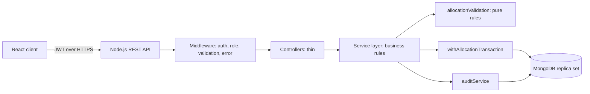
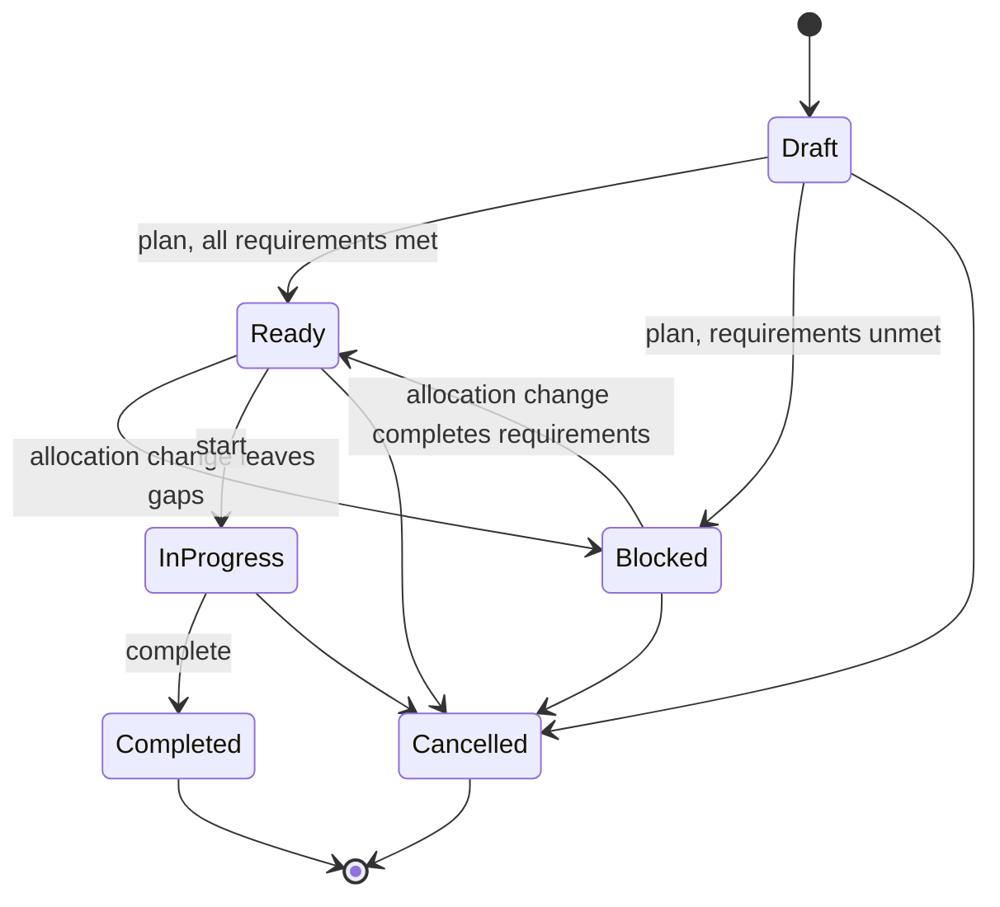

# Shop-Floor Resource Allocation System: High-Level Design

**Source:** `shop_floor_resource_allocation_requirements.md` (SRS v1.0, MVP)
**Stack:** React, Node.js REST API, MongoDB (replica set)

## 1. Context and scope

Manufacturing supervisors manually allocate operators, machines and material
quantities to work orders. The system validates every change on the server,
blocks conflicts, shows readiness, and records an audit trail.

Out of scope (MVP): automatic optimization, telemetry, ERP/MES integration,
payroll, purchasing, auto-replenishment, multi-factory, mobile/offline.

### Resolved open questions (SRS section 14)

| # | Question | Decision for this design |
|---|---|---|
| 1 | Multiple operators/machines per work order | Yes. Requirement carries `operatorCount` and `machineCount` (default 1) |
| 2 | Reserve material at allocation or at start | Reserve at allocation |
| 3 | Operator availability source | Manual entry (`status` field) |
| 4 | Maintenance windows | Not in MVP |
| 5 | Validation overrides | None; all rules are hard rules |
| 6, 7 | Priority scheduling, idle-time baseline | Deferred, documented as limitations |

### Assumptions introduced by this design (to confirm with stakeholders)

- Skills and capabilities are normalized free-text strings (trimmed,
  case-insensitive). No master skill list exists in the SRS.
- Supervisor and Administrator can update material stock.
- Supervisor and Administrator can create, update and cancel work orders.
- An allocation's time window equals its work order's planned window.

## 2. Architecture



Layering rules:

- Controllers parse input and call services; they hold no business rules.
- All validation rules live in `server/src/services/allocationValidation.js`
  as pure functions. The client never re-implements them; it renders the
  error contract returned by the server.
- Errors flow to one central error middleware.

### Folder layout

```
client/src/components/   PascalCase component files
client/src/pages/
client/src/services/     API calls
server/src/routes/
server/src/controllers/
server/src/services/     business logic and validation
server/src/models/       MongoDB schemas
server/src/middleware/   auth, role checks, validation, errors
tests/                   or colocated *.test.js
```

### Technology choices

| Concern | Choice | Reason |
|---|---|---|
| ODM | Mongoose | Schemas, transactions via sessions |
| Input validation | Zod (or Joi) at route boundary | Schema-validated input, rejects operator objects (NoSQL injection) |
| Time zone | `luxon` | Parse plant-zone input to UTC, format for display |
| Auth | JWT, bcrypt password hashes | NFR-04 |
| Backend tests | Jest, Supertest, `mongodb-memory-server` replica set | Transactions need a replica set |
| Frontend tests | Vitest or Jest with React Testing Library | Per project standard |
| Local DB | docker-compose Mongo replica set | Transactions in development |

## 3. Data model

All field names are camelCase. Timestamps are stored in UTC.

| Collection | Key fields | Notes |
|---|---|---|
| `users` | `userId`, `name`, `passwordHash`, `role`, `status` | Roles: `supervisor`, `operator`, `administrator`. Only data needed for auth, authorization and audit (NFR-10) |
| `operators` | `operatorId` (unique), `name`, `skills[]`, `status`, `userId?`, `version` | `userId` links a login to an operator (own-assignment view) |
| `machines` | `machineId` (unique), `name`, `capabilities[]`, `status`, `version` | |
| `materials` | `materialId` (unique), `name`, `unit`, `onHandQuantity`, `reservedQuantity` | Available = on hand minus reserved. Separates reservation from physical stock (SRS implementation note) |
| `workOrders` | `workOrderId` (unique), `description`, `quantity`, `plannedStart`, `plannedEnd`, `status`, `requirements`, `blockedReasons[]`, `version` | `requirements`: `operatorSkill`, `operatorCount`, `machineCapability`, `machineCount`, `materials[{materialId, quantity}]` |
| `allocations` | `allocationId`, `workOrderId`, `resourceType`, `resourceId`, `startTime`, `endTime`, `quantity?`, `status` | One row per resource. `quantity` set for material rows (the reservation). `status`: `active`, `released` |
| `auditEvents` | `eventId`, `actorId`, `action`, `workOrderId`, `before`, `after`, `timestamp`, `reason?` | Append-only |

`version` on operators, machines and work orders is the concurrency guard
(section 5).

### Indexes

- Unique: `operatorId`, `machineId`, `materialId`, `workOrderId`, `userId`.
- `allocations`: `{resourceType, resourceId, status, startTime, endTime}` for
  conflict lookups; `{workOrderId, status}` for readiness.
- `auditEvents`: `{workOrderId, timestamp}`.

Each model story creates its own indexes.

## 4. Validation service (BR-02 to BR-05, BR-07, FR-03, FR-05)

Pure functions with no database access. Services load the data and pass it in.

| Function | Rule |
|---|---|
| `isValidWindow(start, end)` | `end > start` (FR-03) |
| `hasOverlap(a, b)` | `a.start < b.end && a.end > b.start`; back-to-back is allowed (BR-05, FR-06) |
| `isResourceActive(resource)` | Only active resources (BR-02) |
| `hasSkill(operator, skill)` | Normalized match (BR-03) |
| `hasCapability(machine, capability)` | Normalized match (BR-04) |
| `checkMaterial(available, required)` | Sufficient stock, never negative (BR-06, BR-07) |
| `validateAllocation(context)` | Runs all checks and returns every failure |

### Error contract

Every rejection returns HTTP 400/403/409/422 with a body that names the rule
and what to fix (FR-13):

```json
{
  "error": "ValidationError",
  "failures": [
    {
      "rule": "MATERIAL_INSUFFICIENT",
      "message": "Material M-10 has 15 available, 20 required.",
      "fix": "Reduce the quantity or increase stock.",
      "details": { "available": 15, "required": 20 }
    }
  ]
}
```

Rule codes: `INVALID_TIME_WINDOW`, `RESOURCE_INACTIVE`, `SKILL_MISMATCH`,
`CAPABILITY_MISMATCH`, `TIME_CONFLICT`, `MATERIAL_INSUFFICIENT`,
`WORK_ORDER_CLOSED`, `INVALID_TRANSITION`, `FORBIDDEN`.

## 5. Transactions and concurrency (BR-08, NFR-03, NFR-07)

`withAllocationTransaction(fn)` wraps every allocation create, update, release
and work-order cancel:

1. Start a MongoDB session and transaction.
2. Re-load the affected operators, machines and work order inside the
   transaction and re-run `validateAllocation`.
3. Bump `version` on every touched operator, machine and work order. Two
   concurrent transactions touching the same resource then collide on a write
   conflict, and the loser is retried and re-validated (AC-11).
4. Reserve or release material with a conditional update
   (`$inc` where `onHandQuantity - reservedQuantity >= qty`), so available
   stock can never go negative.
5. Write allocation rows, work-order status and the audit event in the same
   transaction.
6. Any failure aborts everything; no partial assignments or reservations
   remain (AC-06).

Bounded retry (for example 3 attempts) on transient write conflicts.

## 6. Work-order status and readiness



- `Blocked` cannot move to `InProgress` (FR-10).
- `Completed` and `Cancelled` accept no allocations (FR-10).
- A work order leaves `Draft` through an explicit plan action. After that,
  `Ready` or `Blocked` is recalculated inside the same transaction as every
  allocation change (BR-09). `InProgress` is not auto-changed.
- Readiness is Ready only when allocated eligible operators and machines meet
  `operatorCount` and `machineCount`, and material reservations cover every
  required quantity. Otherwise `blockedReasons[]` lists each gap, for example
  `MISSING_OPERATOR`, `MISSING_MACHINE`, `INSUFFICIENT_MATERIAL`.
- Cancelling releases all active allocations and returns reserved material;
  audit history is kept (AC-12).
- Changing a work order's planned window with active allocations is rejected
  on the plain update endpoint. The adjust-allocation flow performs the change
  and revalidates every allocation.

## 7. Role-based access (NFR-04, AC-09)

Enforced in API middleware on every route.

| Capability | Supervisor | Operator | Administrator |
|---|---|---|---|
| Manage users, roles | No | No | Yes |
| Manage operators, machines | No | No | Yes |
| Update material stock | Yes | No | Yes |
| Create/update/cancel work orders | Yes | No | Yes |
| Create/adjust/release allocations | Yes | No | No |
| View all work orders, resources, dashboard | Yes | No | Yes |
| View own assignments only | n/a | Yes | n/a |
| View audit history | Yes | No | Yes |

Operators are limited to work orders where they hold an active allocation
(row-level check through `operators.userId`).

## 8. Audit (FR-12, BR-10, NFR-05)

- `auditService.record(session, event)` is called inside the allocation
  transaction, so an audit entry exists if and only if the change committed.
- Events: `ALLOCATION_CREATED`, `ALLOCATION_UPDATED`,
  `ALLOCATION_RELEASED`, with `before` and `after` snapshots.
- Append-only: no update or delete service or route exists, the schema
  rejects modification hooks, and the API exposes read endpoints only.

## 9. Time handling (BR-11)

- One plant time zone from configuration (`PLANT_TIME_ZONE`).
- The API accepts ISO-8601 with offset and converts to UTC for storage.
- The client displays times in the plant time zone.

## 10. API surface

All routes require authentication. Prefix `/api`.

| Module | Endpoints |
|---|---|
| Auth | `POST /auth/login`, `GET /auth/me` |
| Users | `GET/POST /users`, `PATCH /users/:id` |
| Operators | `GET/POST /operators`, `GET/PATCH /operators/:id`, `POST /operators/:id/deactivate` |
| Machines | `GET/POST /machines`, `GET/PATCH /machines/:id`, `POST /machines/:id/deactivate` |
| Materials | `GET/POST /materials`, `GET/PATCH /materials/:id`, `PUT /materials/:id/stock` |
| Work orders | `GET/POST /work-orders`, `GET/PATCH /work-orders/:id`, `POST /work-orders/:id/plan`, `POST /work-orders/:id/status`, `POST /work-orders/:id/cancel` |
| Allocations | `GET/POST /work-orders/:id/allocations`, `PATCH /allocations/:id`, `POST /allocations/:id/release` |
| Readiness | `GET /work-orders/:id/readiness` |
| Availability | `GET /work-orders/:id/availability` |
| Overview | `GET /overview` (filters: `status`, `resourceType`, `from`, `to`) |
| Audit | `GET /work-orders/:id/audit` |
| Operator | `GET /me/assignments` |

## 11. Non-functional mapping

| NFR | Design response |
|---|---|
| NFR-01 Usability | Single allocation form with inline rule feedback |
| NFR-02 Performance | Conflict-lookup indexes; validation touches only affected resources |
| NFR-03 Reliability | Transactions, section 5 |
| NFR-04 Security | JWT, bcrypt, role middleware, login rate limit |
| NFR-05 Auditability | Section 8 |
| NFR-06 Data integrity | Schema validation of IDs, quantities, windows on the server |
| NFR-07 Concurrency | Version bump plus conditional stock update |
| NFR-08 Maintainability | Single validation service, unit tests per rule |
| NFR-09 Compatibility | Current desktop Chrome, Firefox, Edge, Safari |
| NFR-10 Privacy | Minimal user fields; no personal data in logs |

Security baseline (OWASP Top 10): schema-validated input, rejection of query
operator keys such as `$where`, parameterized lookups, no secrets in code,
`.env.example` only.

## 12. Configuration

`.env.example` placeholders: `MONGODB_URI`, `JWT_SECRET`, `PLANT_TIME_ZONE`,
`PORT`, `JWT_EXPIRES_IN`.

## 13. Risks

| Risk | Mitigation |
|---|---|
| Transactions unavailable on standalone Mongo | Replica set in dev, test and production |
| Skill matching too loose or strict | Normalized strings now; master list is a later change |
| Stock drift between reservation and edits | Reserved amount tracked separately; stock edit rejected below reserved |
| Concurrency tests flaky | Deterministic test using two parallel requests against a replica set; retry bound |

## 14. Requirement traceability

| Requirement | Design section | Stories |
|---|---|---|
| FR-01 | 3, 10 | S-04, S-05, S-17 |
| FR-02 | 3, 10 | S-06 |
| FR-03 | 3, 4 | S-07 |
| FR-04 | 10 | S-18 |
| FR-05 | 4, 5 | S-10, S-11 |
| FR-06 | 4, 5 | S-08, S-10, S-12 |
| FR-07 | 6 | S-13 |
| FR-08 | 5, 6 | S-14 |
| FR-09 | 5 | S-15 |
| FR-10 | 6 | S-16 |
| FR-11 | 10 | S-19 |
| FR-12 | 8 | S-09, S-20 |
| FR-13 | 4 | S-01 and each feature story |
| BR-01 | 3 | S-04, S-05, S-06, S-07 |
| BR-02 to BR-05 | 4 | S-08, S-10 |
| BR-06, BR-07 | 4, 5 | S-08, S-11, S-15 |
| BR-08 | 5 | S-10, S-14 |
| BR-09 | 6 | S-13, S-16 |
| BR-10 | 8 | S-09 |
| BR-11 | 9 | S-07 |
| BR-12 | 1 | All (no auto-optimization) |
| NFR-01 | 11 | S-10, S-22 |
| NFR-02 | 3, 11 | Model stories, S-22 |
| NFR-03 | 5 | S-10, S-14 |
| NFR-04 | 7 | S-02 |
| NFR-05 | 8 | S-09 |
| NFR-06 | 11 | S-04 to S-07 |
| NFR-07 | 5 | S-12 |
| NFR-08 | 4 | S-08 |
| NFR-09 | 11 | S-22 |
| NFR-10 | 3, 11 | S-02 |
