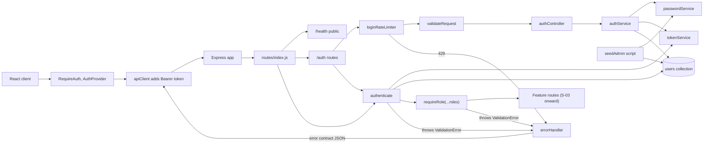
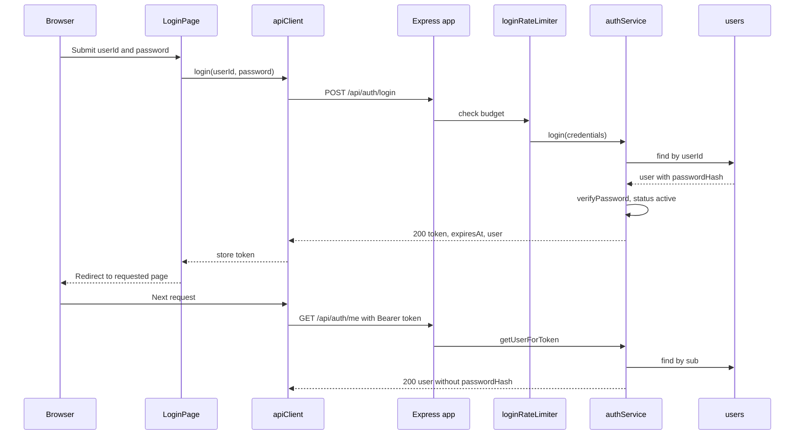
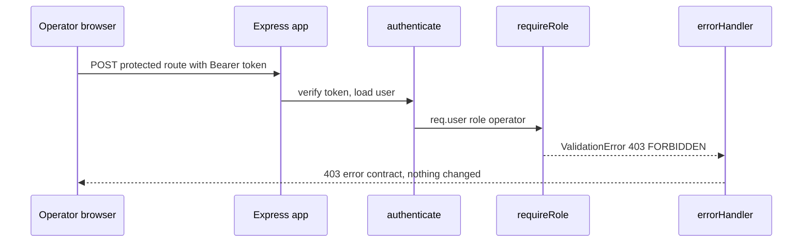

# WIPC-10: Authentication and RBAC: Low-Level Design

## 1. Header

| Field | Value |
|---|---|
| Jira key | WIPC-10 (summary in Jira: `S-02: Authentication and RBAC`) |
| Story label | S-02 in `docs/stories.md` |
| Size | M |
| Depends on | S-01 = WIPC-9 (scaffolding and platform; implemented, see `docs/lld/WIPC-9-low-level-design.md`) |
| Parallel with | None listed in the story. `docs/stories.md` section 4 runs S-02, S-08 and S-09 in the same wave |
| Source documents | Jira WIPC-10, `docs/stories.md` (S-02), `docs/high-level-design.md` (sections 1, 2, 3, 4, 7, 9, 10, 11, 12), `shop_floor_resource_allocation_requirements.md` (section 5, NFR-04, NFR-06, NFR-10, AC-09), `.github/copilot-instructions.md`, existing code under `server/src` and `client/src` |
| Date | 2026-10-30 |

Key mapping used: the Jira summary of WIPC-10 is `S-02: Authentication and
RBAC`, so WIPC-10 = S-02 (the "same number" mapping would be wrong). The
Jira search returned the issue (id 10264) with a truncated description only;
the full story block is taken from `docs/stories.md` S-02, which is the text
that was pushed to Jira (OQ-01).

Dependent stories (Jira key = story label): S-03, S-04, S-05, S-06 (use
`authenticate` and `requireRole`, reuse `User` and `passwordService`), S-21
(uses `req.user`). Stories in "Depends on": S-01 only.

## 2. Story summary

Users log in with a user ID and password and receive a JWT. Every API route
except `GET /api/health` and `POST /api/auth/login` requires a valid token,
and the server enforces the user's role through middleware, not only through
hidden UI controls. The story adds the `User` model, password hashing, login
and `me` endpoints, `authenticate` and `requireRole(...roles)` middleware,
login rate limiting, a seed script for the first Administrator, and the
client login page, auth context and route guard.

In scope:

- `User` model and `users` collection (unique `userId`).
- `passwordService` (bcrypt), `tokenService` (JWT), `authService`.
- `POST /api/auth/login`, `GET /api/auth/me`.
- `authenticate` (applied to everything after `/health` and `/auth`),
  `requireRole(...roles)`, role constants.
- Login rate limiter, generic credential errors.
- Seed script for the first Administrator from environment variables.
- Error contract additions: statuses 401 and 429; rules `UNAUTHENTICATED`,
  `INVALID_CREDENTIALS`, `ACCOUNT_INACTIVE`, `RATE_LIMITED`; `FORBIDDEN`
  (already in the HLD list).
- Client: login page, auth context, route guard, `Authorization` header,
  401 handling, header user display and logout.

Out of scope (other stories):

- User CRUD, role changes, deactivation endpoint (S-03). S-02 only honors
  `status` at login and on every request.
- Per-feature role arrays on operator, machine, material, work-order,
  allocation, audit and overview routes (S-04 and later apply
  `requireRole`).
- Row-level "own assignments only" check for operators (S-10, S-21).
- Allocation validation rules in `allocationValidation` (S-08), audit
  events for allocations (S-09).
- Password change or reset, refresh tokens, token revocation list, logout
  endpoint, security headers and CORS (S-22 or a later story).

## 3. Requirements

### 3.1 Story acceptance criteria

| ID | Given / When / Then | SRS AC |
|---|---|---|
| WIPC10-AC1 | Given valid credentials, when a user logs in, then a JWT is returned and `GET /api/auth/me` returns the user without `passwordHash`. | None. Supports NFR-04, NFR-10 |
| WIPC10-AC2 | Given no or an invalid token, when any protected route is called, then the response is 401. | None. Supports NFR-04 |
| WIPC10-AC3 | Given a role not permitted for a route, when it is called, then the response is 403 with rule `FORBIDDEN`. | AC-09 (the middleware comes from S-02; the allocation route-level test is proven in S-10) |
| WIPC10-AC4 | Given repeated failed logins from one source, then further attempts are rate limited. | None. Supports NFR-04 |
| WIPC10-AC5 | Given a deactivated user, when they log in, then login is rejected. | None. Supports NFR-04 |

Sub-tasks (story checklist, referenced as ST-1 to ST-6):

| ID | Sub-task |
|---|---|
| ST-1 | `User` model: `userId`, `name`, `passwordHash`, `role`, `status`. |
| ST-2 | bcrypt hashing; login controller and service. |
| ST-3 | `authenticate` and `requireRole(...roles)` middleware. |
| ST-4 | Login rate limiting; no personal data or tokens in logs. |
| ST-5 | Seed script that creates the first Administrator from environment variables (no credentials in code). |
| ST-6 | Login page, auth context, route guard in the client. |

### 3.2 Functional requirements

| ID | Requirement | Source |
|---|---|---|
| LLD-FR-01 | A `users` collection stores `userId` (unique), `name`, `passwordHash`, `role` (`supervisor`, `operator`, `administrator`) and `status` (`active`, `inactive`, default `active`). `passwordHash` is excluded from queries by default. | ST-1, HLD section 3, SRS section 5 |
| LLD-FR-02 | Passwords are stored only as bcrypt hashes; a `passwordService` exposes `hashPassword` and `verifyPassword` for reuse by S-03 and the seed script. | ST-2, NFR-04 |
| LLD-FR-03 | `POST /api/auth/login` accepts `{ userId, password }`, and for valid credentials of an active user returns 200 with a signed JWT, `tokenType`, `expiresAt` (UTC) and the public user. | WIPC10-AC1, ST-2 |
| LLD-FR-04 | `GET /api/auth/me` returns the authenticated user (`userId`, `name`, `role`, `status`) and never `passwordHash`. | WIPC10-AC1 |
| LLD-FR-05 | `authenticate` reads `Authorization: Bearer <token>`, verifies signature, algorithm and expiry, loads the user from the database on every request, and returns 401 `UNAUTHENTICATED` when the token is missing, malformed, invalid, expired, or its user is missing or inactive. | WIPC10-AC2, ST-3 |
| LLD-FR-06 | Every `/api` route is authenticated by default: `/health` and `POST /auth/login` are the only public routes, and `authenticate` is mounted before every other route so later stories are protected without extra wiring. | WIPC10-AC2, HLD section 10 |
| LLD-FR-07 | `requireRole(...roles)` allows the request only when `req.user.role` is in `roles`; otherwise it returns 403 with rule `FORBIDDEN`, naming the user's role and the allowed roles. Role comes from the database user, not from the token. | WIPC10-AC3, ST-3, SRS section 5, AC-09 |
| LLD-FR-08 | Failed logins are rate limited per source (client IP) with a configurable maximum and window; once exceeded, login attempts return 429 `RATE_LIMITED` with a `Retry-After` header. Successful logins do not count. | WIPC10-AC4, ST-4 |
| LLD-FR-09 | A user with `status` `inactive` cannot log in; login returns 403 `ACCOUNT_INACTIVE` (only after the password is verified) and no token is issued. | WIPC10-AC5 |
| LLD-FR-10 | Unknown user ID and wrong password return the same 401 `INVALID_CREDENTIALS` response, and the unknown-user path still performs a bcrypt comparison. | NFR-04, OWASP A07 |
| LLD-FR-11 | No response, log line or JWT payload contains `passwordHash`, the plain password or personal data beyond `userId`. Logins and `me` responses are sent with `Cache-Control: no-store`. | WIPC10-AC1, ST-4, NFR-10 |
| LLD-FR-12 | The login body is validated with a strict Zod schema through `validateRequest`; operator payloads such as `{ "userId": { "$gt": "" } }` are rejected with 400 `INVALID_INPUT`. | Story test notes, NFR-06 |
| LLD-FR-13 | `ValidationError` accepts statuses 401 and 429 in addition to 400, 403, 404, 409 and 422, and `errorHandler` returns them in the standard contract. | WIPC10-AC2, WIPC10-AC4, FR-13 |
| LLD-FR-14 | A seed script creates the first Administrator from `ADMIN_USER_ID`, `ADMIN_NAME` and `ADMIN_PASSWORD`; it is idempotent, never prints the password and stops with a clear message when variables are invalid. | ST-5 |
| LLD-FR-15 | `loadConfig` and `.env.example` gain `LOGIN_RATE_LIMIT_MAX`, `LOGIN_RATE_LIMIT_WINDOW_MS` (with defaults) and the three seed variables (placeholders only). | ST-4, ST-5, HLD section 12 |
| LLD-FR-16 | The client has a login page (user ID and password) that calls the login endpoint, stores the token, and shows server rule failures (rule, message, fix) through the existing notification component, keeping the entered user ID. | ST-6, WIPC10-AC1, FR-13 |
| LLD-FR-17 | An auth context holds the current user and status (`loading`, `authenticated`, `anonymous`), restores the session from a stored token through `GET /auth/me`, and offers `login` and `logout`. | ST-6 |
| LLD-FR-18 | A route guard redirects anonymous users to `/login` (remembering the target page) and shows a "not permitted" view when the user's role is not in the route's allowed roles; the server remains the authority. | ST-6, SRS section 5 |
| LLD-FR-19 | `apiClient` sends the stored token in `Authorization: Bearer`; on a 401 from any call other than login it clears the session so the guard returns the user to `/login`. | ST-6, WIPC10-AC2 |
| LLD-FR-20 | The app header shows the signed-in user's name and role label and a Logout control that clears the token and session. | ST-6 |

### 3.3 Non-functional requirements

| ID | Requirement | Source |
|---|---|---|
| LLD-NFR-01 | Authentication and role checks are enforced in API middleware on every route; the client guard is a convenience only. | NFR-04, SRS section 5, story rules |
| LLD-NFR-02 | bcrypt hashing with cost 12; JWT signed with HS256 using `JWT_SECRET` (at least 32 characters, from environment); verification pins `algorithms: ['HS256']`; tokens expire after `JWT_EXPIRES_IN`. | NFR-04, OWASP A02 |
| LLD-NFR-03 | Store and expose only user data needed for authentication, authorization and audit (`userId`, `name`, `role`, `status`); the JWT carries only `sub`, `iat`, `exp`; no personal data, tokens or passwords in logs. | NFR-10, ST-4 |
| LLD-NFR-04 | All login input is schema-validated on the server; operator keys and non-string values are rejected before any query; Mongoose `sanitizeFilter` stays on; the token subject is checked to be a string before lookup. | NFR-06, OWASP A03 |
| LLD-NFR-05 | Brute-force resistance: rate limiting, generic credential errors, constant-work password comparison for unknown users. | NFR-04, OWASP A07 |
| LLD-NFR-06 | 401, 403 and 429 responses follow the HLD error contract (`error`, `failures[]` with `rule`, `message`, `fix`). | FR-13, story rules |
| LLD-NFR-07 | Authentication and authorization logic lives in services and middleware; controllers only call services; the client holds no validation or authorization rules beyond hiding views. | NFR-08, story rules, project instructions |
| LLD-NFR-08 | The auth lookup per request uses the unique `userId` index so the added cost stays well within the 2 second target. | NFR-02 |
| LLD-NFR-09 | Timestamps are UTC ISO-8601 (`expiresAt`); no time zone logic is added. | BR-11, HLD section 9 |
| LLD-NFR-10 | No credentials in code: secrets and seed credentials come from environment variables; only `.env.example` with placeholders is committed; `.env` is never read by tooling. | Sensitive-information rules, ST-5 |
| LLD-NFR-11 | Automated tests cover 401, 403, rate limit, deactivated user, no hash in any response and injection payloads. | NFR-08, story test notes |
| LLD-NFR-12 | Code follows camelCase, 2 spaces, semicolons, single quotes, lines under 80 characters, async/await, central error middleware. | Coding standards |

### 3.4 Constraints and assumptions

- Stack as in WIPC-9: Express 5 (async handler errors reach `errorHandler`),
  Mongoose 8, Zod 4, CommonJS on the server, React 19 with Vite.
- New server dependencies: `bcryptjs`, `jsonwebtoken`, `express-rate-limit`
  (OQ-07).
- Role values follow the HLD data model: `supervisor`, `operator`,
  `administrator`. Display labels: Manufacturing Supervisor, Shop-Floor
  Operator, Administrator (SRS section 5).
- `GET /api/health` stays public (WIPC-9 OQ-02 resolved: stays public).
- The token is a bearer token returned in the response body and kept in
  `sessionStorage` on the client (OQ-05). HTTPS termination is assumed in
  deployment (HLD section 2: "JWT over HTTPS").
- The rate limiter uses an in-memory store (single server process for the
  MVP, OQ-02).
- Defaults proposed for unspecified values: 5 failed attempts per 15 minutes
  per IP, token lifetime 1 hour (`JWT_EXPIRES_IN` already defaults to `1h`).
- `req.user` shape is the contract for later stories:
  `{ id, userId, name, role, status }`.
- Existing WIPC-9 code and tests need small changes (section 13, OQ-13).

## 4. Design overview



Layers touched: route, middleware (rate limiter, validation, authenticate,
requireRole), controller, service (auth, password, token, seed), model
(`User`), config, error type, client pages, components, services.

## 5. Data design

New collection `users` (Mongoose model `User`, file
`server/src/models/User.js`). Only this collection is new; no migration is
needed (MongoDB creates the collection and index on first use; tests call
`User.init()` to build the index).

| Field | Type | Required | Default | Rules |
|---|---|---|---|---|
| `userId` | String | yes | none | `trim`, `lowercase`, 1 to 64 characters; unique login identifier |
| `name` | String | yes | none | `trim`, 1 to 100 characters |
| `passwordHash` | String | yes | none | bcrypt hash; `select: false` |
| `role` | String | yes | none | enum `supervisor`, `operator`, `administrator` |
| `status` | String | yes | `active` | enum `active`, `inactive` |
| `createdAt`, `updatedAt` | Date | auto | auto | Mongoose `timestamps: true`, stored UTC |

Indexes:

- Unique `{ userId: 1 }` (HLD section 3). S-03 lists "Unique index on
  `userId`" as its own sub-task; this story creates it because login needs it
  (OQ-09). S-03 must not define it a second time.

Model details:

- Exports: `User` (default), `ROLES` (`{ supervisor, operator,
  administrator }`), `USER_STATUSES` (`{ active, inactive }`).
- `toJSON` transform deletes `passwordHash` and `__v` (defense in depth);
  responses still use the whitelist `toPublicUser`.
- `version` is not added: users are not part of the allocation concurrency
  guard (HLD section 3).
- Operator-to-user link lives on `operators.userId` (S-04); nothing is added
  to `users`.

## 6. API design

All endpoints use prefix `/api`. All error bodies follow the HLD contract.

### 6.1 `POST /api/auth/login`

| Item | Value |
|---|---|
| Roles allowed | Public (no token) |
| Middleware order | `loginRateLimiter`, `validateRequest({ body })`, controller |
| Request schema (Zod) | `z.strictObject({ userId: z.string().trim().toLowerCase().min(1).max(64), password: z.string().min(1).refine((v) => Buffer.byteLength(v) <= 72) })` |
| Status codes | 200, 400 `INVALID_INPUT`, 401 `INVALID_CREDENTIALS`, 403 `ACCOUNT_INACTIVE`, 429 `RATE_LIMITED`, 500 |
| Headers | `Cache-Control: no-store`; on 429 `Retry-After: <seconds>` |

The 72 byte limit matches the bcrypt input limit, so no password is silently
truncated.

Request:

```json
{ "userId": "sup01", "password": "correct horse battery staple" }
```

Response 200:

```json
{
  "token": "<jwt>",
  "tokenType": "Bearer",
  "expiresAt": "2026-10-30T11:15:30.000Z",
  "user": {
    "userId": "sup01",
    "name": "Asha Rao",
    "role": "supervisor",
    "status": "active"
  }
}
```

Response 401 (unknown user ID or wrong password, same body for both):

```json
{
  "error": "ValidationError",
  "failures": [
    {
      "rule": "INVALID_CREDENTIALS",
      "message": "The user ID or password is incorrect.",
      "fix": "Check your user ID and password and try again."
    }
  ]
}
```

Response 403 (correct password, deactivated user):

```json
{
  "error": "ValidationError",
  "failures": [
    {
      "rule": "ACCOUNT_INACTIVE",
      "message": "This account is deactivated.",
      "fix": "Ask an Administrator to reactivate the account."
    }
  ]
}
```

Response 429:

```json
{
  "error": "ValidationError",
  "failures": [
    {
      "rule": "RATE_LIMITED",
      "message": "Too many failed login attempts.",
      "fix": "Wait 15 minutes before trying again.",
      "details": { "retryAfterSeconds": 900 }
    }
  ]
}
```

Response 400 for `{ "userId": { "$gt": "" }, "password": "x" }`:

```json
{
  "error": "ValidationError",
  "failures": [
    {
      "rule": "INVALID_INPUT",
      "message": "body.userId.$gt: operator keys are not allowed.",
      "fix": "Send plain values only; remove keys that start with $.",
      "details": { "path": "body.userId.$gt" }
    }
  ]
}
```

### 6.2 `GET /api/auth/me`

| Item | Value |
|---|---|
| Roles allowed | Any authenticated active user |
| Middleware order | `authenticate`, controller |
| Request schema | No body; query and params are ignored |
| Status codes | 200, 401 `UNAUTHENTICATED`, 500 |
| Headers | `Cache-Control: no-store` |

Response 200:

```json
{
  "user": {
    "userId": "sup01",
    "name": "Asha Rao",
    "role": "supervisor",
    "status": "active"
  }
}
```

### 6.3 Behavior on every other `/api` route

| Case | Status | Rule |
|---|---|---|
| No `Authorization` header, wrong scheme, empty token | 401 | `UNAUTHENTICATED` |
| Bad signature, wrong algorithm, expired token, subject not a string | 401 | `UNAUTHENTICATED` |
| Valid token, user missing or `inactive` | 401 | `UNAUTHENTICATED` |
| Valid token, role not in `requireRole` list | 403 | `FORBIDDEN` |

Because `authenticate` runs before the 404 handler for all `/api` paths, an
unknown `/api` path without a token returns 401, not 404; with a token it
returns 404 `NOT_FOUND`. Paths outside `/api` still return 404.

Response 401:

```json
{
  "error": "ValidationError",
  "failures": [
    {
      "rule": "UNAUTHENTICATED",
      "message": "A valid token is required.",
      "fix": "Sign in again."
    }
  ]
}
```

Response 403:

```json
{
  "error": "ValidationError",
  "failures": [
    {
      "rule": "FORBIDDEN",
      "message": "Role operator cannot perform this action.",
      "fix": "Sign in as supervisor or ask an Administrator for access.",
      "details": { "role": "operator", "allowedRoles": ["supervisor"] }
    }
  ]
}
```

### 6.4 Reference: role matrix for later stories

Each feature story applies `requireRole` using HLD section 7. S-02 only
provides the mechanism and tests it with test-only routes.

| Capability | Roles to pass to `requireRole` |
|---|---|
| Manage users, operators, machines | `administrator` |
| Update material stock, create/update/cancel work orders | `supervisor`, `administrator` |
| Create/adjust/release allocations | `supervisor` |
| View work orders, resources, dashboard, audit history | `supervisor`, `administrator` |
| Own assignments (`GET /me/assignments`) | `operator` (plus row-level check in S-21) |

## 7. Service and business logic

### 7.1 Modules and signatures

| Module | Function or class | Params | Returns | Throws |
|---|---|---|---|---|
| `server/src/models/User.js` | `User`, `ROLES`, `USER_STATUSES` | none | Mongoose model and constants | none |
| `server/src/services/passwordService.js` | `hashPassword(plain, rounds)` | plain string, rounds default 12 | Promise of bcrypt hash | driver error |
| | `verifyPassword(plain, hash)` | plain string, hash | Promise of boolean | none |
| `server/src/services/tokenService.js` | `signToken(userId, config)` | user ID, config | JWT string (`sub`, `iat`, `exp`) | none |
| | `verifyToken(token, config)` | token, config | decoded `{ sub, exp }` | `ValidationError` 401 `UNAUTHENTICATED` |
| `server/src/services/authService.js` | `login(credentials, config)` | `{ userId, password }`, config | `{ token, tokenType, expiresAt, user }` | `ValidationError` 401 `INVALID_CREDENTIALS`, 403 `ACCOUNT_INACTIVE` |
| | `getUserForToken(token, config)` | token, config | `{ id, userId, name, role, status }` | `ValidationError` 401 `UNAUTHENTICATED` |
| | `toPublicUser(user)` | user document or lean object | `{ userId, name, role, status }` | none |
| `server/src/services/seedService.js` | `seedAdministrator({ userId, name, password })` | seed values | `{ created: boolean }` | none for duplicates; driver error otherwise |
| `server/src/middleware/authenticate.js` | `authenticate(req, res, next)` | Express args | sets `req.user` | `ValidationError` 401 |
| `server/src/middleware/requireRole.js` | `requireRole(...roles)` | role strings from `ROLES` | Express middleware | at construction: `TypeError` if empty or unknown role; at request: `ValidationError` 403 `FORBIDDEN`, 401 if `req.user` missing |
| `server/src/middleware/loginRateLimiter.js` | `createLoginRateLimiter(config)` | config | Express middleware | `ValidationError` 429 `RATE_LIMITED` |
| `server/src/controllers/authController.js` | `login(req, res)`, `me(req, res)` | Express args | JSON 200 | none |
| `server/src/routes/authRoutes.js` | `createAuthRoutes(config)` | config | Express router | none |
| `server/src/routes/index.js` | `createRoutes(config)` | config | Express router (changed from a plain router) | none |
| `server/src/app.js` | `createApp(extend, config)` | test hook, config | Express app; sets `app.locals.config` | `TypeError` if config missing |
| `server/src/scripts/seedAdmin.js` | script | environment | exit code 0 or 1 | none |

Authorization rules (role membership, active status, token validity) live in
`requireRole`, `authenticate` and `authService`; no controller and no client
code re-implements them. They are not allocation rules, so they do not belong
in `allocationValidation` (S-08).

### 7.2 Evaluation order

Login (`POST /api/auth/login`):

1. `express.json` parses the body (WIPC-9).
2. `loginRateLimiter`: if the source already used its failed-attempt budget,
   throw 429 `RATE_LIMITED`.
3. `validateRequest`: operator-key scan, then strict Zod schema (400).
4. `authService.login`:
   1. Find the user by `userId` with `passwordHash`.
   2. Compare the password with the stored hash, or with a dummy hash when
      the user does not exist (constant work).
   3. If the user is missing or the password differs: 401
      `INVALID_CREDENTIALS`.
   4. If `status` is not `active`: 403 `ACCOUNT_INACTIVE`.
   5. Sign the token and return it.

Every other `/api` request:

1. `routes/index.js` mounts `/health` (public) and `/auth` first.
2. `authenticate` (all remaining routes): parse header, verify token, load
   user, require `status` `active`, set `req.user`.
3. Feature router: `requireRole(...roles)`, then `validateRequest`, then the
   controller (S-03 onward).
4. Errors go to `errorHandler`.

### 7.3 Pseudocode

Token service:

```js
function signToken(userId, config) {
  return jwt.sign({}, config.jwtSecret, {
    algorithm: 'HS256',
    subject: userId,
    expiresIn: config.jwtExpiresIn,
  });
}

function verifyToken(token, config) {
  try {
    const payload = jwt.verify(token, config.jwtSecret, {
      algorithms: ['HS256'],
    });
    if (typeof payload.sub !== 'string') throw new Error('bad subject');
    return payload;
  } catch {
    throw unauthenticated();
  }
}
```

`expiresAt` in the login response is `new Date(payload.exp * 1000)` from
`jwt.decode(token)`, serialized with `toISOString()`.

Auth service:

```js
async function login({ userId, password }, config) {
  const user = await User.findOne({ userId })
    .select('+passwordHash')
    .lean();
  const hash = user ? user.passwordHash : await getDummyHash();
  const matches = await verifyPassword(password, hash);
  if (!user || !matches) throw invalidCredentials();
  if (user.status !== USER_STATUSES.active) throw accountInactive();
  const token = signToken(user.userId, config);
  const { exp } = jwt.decode(token);
  return {
    token,
    tokenType: 'Bearer',
    expiresAt: new Date(exp * 1000).toISOString(),
    user: toPublicUser(user),
  };
}

async function getUserForToken(token, config) {
  const { sub } = verifyToken(token, config);
  const user = await User.findOne({ userId: sub }).lean();
  if (!user || user.status !== USER_STATUSES.active) {
    throw unauthenticated();
  }
  return { id: String(user._id), ...toPublicUser(user) };
}
```

`getDummyHash()` hashes a fixed string once (lazily, cost 12) and caches it.

Middleware:

```js
async function authenticate(req, res, next) {
  const match = /^Bearer (\S+)$/.exec(req.get('authorization') ?? '');
  if (!match) throw unauthenticated();
  req.user = await getUserForToken(match[1], req.app.locals.config);
  next();
}

function requireRole(...roles) {
  if (roles.length === 0 || !roles.every((r) => r in ROLES)) {
    throw new TypeError('requireRole needs valid roles.');
  }
  return (req, res, next) => {
    if (!req.user) throw unauthenticated();
    if (!roles.includes(req.user.role)) throw forbidden(req.user.role, roles);
    next();
  };
}
```

`forbidden` builds the 403 `FORBIDDEN` failure with `details: { role,
allowedRoles }`. Throwing inside Express 5 middleware (sync or async) reaches
`errorHandler`.

Rate limiter:

```js
function createLoginRateLimiter(config) {
  return rateLimit({
    windowMs: config.loginRateLimitWindowMs,
    limit: config.loginRateLimitMax,
    skipSuccessfulRequests: true,
    standardHeaders: 'draft-7',
    legacyHeaders: false,
    handler: (req, res, next) => {
      const seconds = Math.max(
        1,
        Math.ceil((req.rateLimit.resetTime - Date.now()) / 1000),
      );
      res.set('Retry-After', String(seconds));
      next(rateLimited(seconds));
    },
  });
}
```

The limiter is created per `createRoutes(config)` call, so tests get an
isolated counter per app. Requests answered with a status below 400 are not
counted; 400, 401 and 403 answers are.

Seed service and script:

```js
async function seedAdministrator({ userId, name, password }) {
  const exists = await User.exists({ role: ROLES.administrator });
  if (exists) return { created: false };
  const passwordHash = await hashPassword(password);
  try {
    await User.create({
      userId, name, passwordHash, role: ROLES.administrator,
    });
    return { created: true };
  } catch (err) {
    if (err.code === 11000) return { created: false };
    throw err;
  }
}
```

The script loads the root `.env` with `dotenv` (same as `server.js`), parses
`ADMIN_USER_ID`, `ADMIN_NAME`, `ADMIN_PASSWORD` (at least 12 characters) with
Zod, reports only variable names on failure, connects, calls
`seedAdministrator`, prints `Administrator created.` or `An administrator
already exists; nothing changed.`, disconnects, and exits with 0 or 1. It is
run with `npm run seed:admin -w server`.

Config additions (`server/src/config/index.js`):

```js
LOGIN_RATE_LIMIT_MAX: z.coerce.number().int().min(1).default(5),
LOGIN_RATE_LIMIT_WINDOW_MS: z.coerce
  .number().int().min(1000).default(900000),
```

mapped to `loginRateLimitMax` and `loginRateLimitWindowMs`. The seed
variables are not part of `loadConfig`; only the seed script reads them.

### 7.4 Transactions, concurrency, audit

- No allocation, material or work order is touched, so no audit event is
  written and no `version` guard is needed. Allocation audit is S-09.
- No MongoDB transaction is needed: login is read-only; the seed writes one
  document.
- Concurrency: two simultaneous seed runs are safe because the unique
  `userId` index rejects the second insert (duplicate key 11000 is treated as
  "already exists").
- Role and status are read from the database on each request, so a role
  change or deactivation (S-03) takes effect on the next request without a
  token blacklist.
- Logging: nothing from this story logs user IDs, passwords, tokens or
  request bodies. `errorHandler` keeps logging only `name`, `message` and
  `stack` of unexpected errors.

## 8. Sequence diagrams

Success: login, then call a protected route.



Failure: wrong password, deactivated user and rate limit.

```mermaid
sequenceDiagram
  participant U as Browser
  participant A as apiClient
  participant E as Express app
  participant R as loginRateLimiter
  participant S as authService
  participant X as errorHandler
  participant N as Notification
  U->>A: login with wrong password
  A->>E: POST /api/auth/login
  E->>R: check budget
  R->>S: login(credentials)
  S-->>X: ValidationError 401 INVALID_CREDENTIALS
  X-->>A: 401 error contract JSON
  A-->>U: ApiError with failures
  U->>N: notifyError(ApiError)
  N-->>U: Shows rule, message and fix; user ID kept
  Note over U,R: After the limit is reached
  U->>A: login again
  A->>E: POST /api/auth/login
  E->>R: budget exhausted
  R-->>X: ValidationError 429 RATE_LIMITED
  X-->>A: 429 with Retry-After
```

Failure: role not permitted on a protected route.



## 9. Error handling

| Rule code | HTTP | Message template | Fix template |
|---|---|---|---|
| `UNAUTHENTICATED` | 401 | `A valid token is required.` | `Sign in again.` |
| `INVALID_CREDENTIALS` | 401 | `The user ID or password is incorrect.` | `Check your user ID and password and try again.` |
| `ACCOUNT_INACTIVE` | 403 | `This account is deactivated.` | `Ask an Administrator to reactivate the account.` |
| `FORBIDDEN` | 403 | `Role {role} cannot perform this action.` | `Sign in as {allowedRoles} or ask an Administrator for access.` |
| `RATE_LIMITED` | 429 | `Too many failed login attempts.` | `Wait {minutes} minutes before trying again.` |
| `INVALID_INPUT` | 400 | `{path}: {zodMessage}` or `{path}: operator keys are not allowed.` | Defined in WIPC-9 |
| `INTERNAL_ERROR` | 500 | Defined in WIPC-9 | Defined in WIPC-9 |

Notes:

- `ValidationError` allowed statuses become 400, 401, 403, 404, 409, 422,
  429 (HLD lists 400, 403, 409, 422; WIPC-9 added 404). `ValidationError.test`
  changes accordingly (OQ-03).
- `INVALID_CREDENTIALS` hides which part failed. `ACCOUNT_INACTIVE` is only
  returned after the correct password (OQ-06).
- Startup: invalid `LOGIN_RATE_LIMIT_*` values fail `loadConfig` with the
  variable names only (WIPC-9 behavior).
- Seed errors print variable names or a generic message, never values.

## 10. Client design

New and changed files under `client/src/`:

| File | Purpose |
|---|---|
| `services/tokenStorage.js` | `getToken()`, `setToken(token)`, `clearToken()` over `sessionStorage` key `shopfloor.token` |
| `services/authService.js` | `login(userId, password)` calls `POST /auth/login`; `getCurrentUser()` calls `GET /auth/me` |
| `services/apiClient.js` (changed) | `authHeaders()` returns `{ Authorization: 'Bearer <token>' }` when a token exists; `setUnauthorizedHandler(fn)`; on a 401 for any path except `/auth/login` calls the handler, then throws the `ApiError` as before |
| `components/AuthProvider.jsx` | Context `{ user, status, login, logout }`; exports `useAuth()` |
| `components/RequireAuth.jsx` | Layout route guard with optional `roles` prop; renders `Outlet` |
| `components/ForbiddenView.jsx` | Shown by the guard when the role is not allowed |
| `components/AppShell.jsx` (changed) | Shows user name, role label and a Logout button when authenticated; hides navigation when anonymous |
| `pages/LoginPage.jsx` | Form with user ID and password, submit button, error display through `useNotification` |
| `main.jsx` (changed) | Providers: `BrowserRouter`, `NotificationProvider`, `AuthProvider`, `App` |
| `App.jsx` (changed) | Route table: `/login` public; everything else under `<Route element={<RequireAuth />}>` |

State:

- `AuthProvider` state: `status` (`loading`, `authenticated`, `anonymous`)
  and `user`. On mount, if a token exists it calls `getCurrentUser()`; on
  success status is `authenticated`, on failure the token is cleared and
  status is `anonymous`. Without a token status is `anonymous` immediately.
- `login(userId, password)`: calls the service, stores the token, sets the
  user. Errors propagate to the caller (the login page).
- `logout()`: clears the token and sets `anonymous`. There is no server call
  (OQ-05).
- `AuthProvider` registers the unauthorized handler with `apiClient`: it
  clears the token and sets `anonymous`.

Behavior:

- `RequireAuth`: `loading` shows a loading text; `anonymous` navigates to
  `/login` with `state.from`; authenticated with a role outside `roles` shows
  `ForbiddenView`. The guard hides screens only; the server enforces roles
  (LLD-NFR-01).
- `LoginPage`: both fields required; submit disabled while the request runs;
  on success navigate to `state.from` or `/`; an already authenticated user
  is redirected to `/`.
- Error display: `notifyError(error)` renders rule, message and fix in the
  existing `Notification` (for example `INVALID_CREDENTIALS`,
  `ACCOUNT_INACTIVE`, `RATE_LIMITED` with the wait time). The user ID stays
  in the field; the password field is cleared on a credential failure only,
  not on validation or rate-limit errors (OQ-14).
- Role labels map: `supervisor` to Manufacturing Supervisor, `operator` to
  Shop-Floor Operator, `administrator` to Administrator.
- The token is never rendered, logged or placed in a URL.

## 11. Security

- Authentication: bearer JWT (HS256, `sub` only, expiry from
  `JWT_EXPIRES_IN`); every route after `/health` and `/auth` goes through
  `authenticate`, so new routes are protected by default (NFR-04,
  OWASP A01, A07).
- Authorization: `requireRole` in middleware, role read from the database
  per request; unknown or empty role lists fail at startup.
- Passwords: bcrypt cost 12 through `bcryptjs`; 72 byte input limit enforced
  by the schema; plain passwords are never stored or logged; `passwordHash`
  is `select: false`, excluded by `toPublicUser` and by the `toJSON`
  transform.
- Brute force: per-IP failed-login limit, generic credential error,
  dummy-hash comparison for unknown users, `Retry-After` header.
- Injection: strict Zod schema, operator-key scan (WIPC-9), `sanitizeFilter`,
  and a `typeof sub === 'string'` check before the lookup (NFR-06,
  OWASP A03).
- Secrets: `JWT_SECRET`, seed credentials and rate limit values come from the
  environment; `.env.example` holds placeholders only; the seed script never
  prints the password.
- Privacy: only `userId`, `name`, `role`, `status` are stored or returned;
  no personal data or tokens in logs (NFR-10).
- Responses with credentials or user data carry `Cache-Control: no-store`.
- Client: token in `sessionStorage` (cleared when the tab closes; readable by
  injected scripts, so React escaping and a later CSP matter, OQ-05).
- When the server runs behind a reverse proxy, `trust proxy` must be set so
  the limiter sees the real client IP (OQ-02, deployment note for the
  README).

## 12. Test design

Backend tests use Jest and Supertest against the in-memory replica set from
WIPC-9 (`server/tests/helpers/testDb.js`). A new helper
`server/tests/helpers/testConfig.js` builds a config through `loadConfig`
with a test-only 32 character secret and a low rate limit (for example 3),
and `server/tests/helpers/authHelpers.js` creates users (bcrypt rounds 4) and
tokens.

| ID | Test | Layer | Covers |
|---|---|---|---|
| T-01 | `hashPassword` returns a bcrypt hash different from the plain text; `verifyPassword` accepts the right and rejects a wrong password | Unit | LLD-FR-02, LLD-NFR-02 |
| T-02 | `signToken` and `verifyToken` round trip; payload has only `sub`, `iat`, `exp` | Unit | LLD-NFR-02, LLD-NFR-03 |
| T-03 | `verifyToken` rejects an expired token, a tampered signature, an `alg: none` token, a token signed with another secret, and a non-string subject | Unit | LLD-FR-05, WIPC10-AC2 |
| T-04 | `User` requires `userId`, `name`, `passwordHash`, `role`; rejects an unknown role or status; defaults `status` to `active`; unique index rejects a duplicate `userId`; `passwordHash` not selected by default | Integration | LLD-FR-01, ST-1 |
| T-05 | `toPublicUser` returns only `userId`, `name`, `role`, `status`; `toJSON` never contains `passwordHash` | Unit | LLD-FR-11, WIPC10-AC1 |
| T-06 | Login with valid credentials returns 200 with `token`, `tokenType`, UTC `expiresAt` and the public user | Supertest | LLD-FR-03, WIPC10-AC1 |
| T-07 | Login response body contains no `passwordHash` anywhere and has `Cache-Control: no-store` | Supertest | LLD-FR-11, WIPC10-AC1 |
| T-08 | `GET /api/auth/me` with the login token returns the user without `passwordHash` | Supertest | LLD-FR-04, WIPC10-AC1 |
| T-09 | Wrong password and unknown user ID return the same 401 body with `INVALID_CREDENTIALS` | Supertest | LLD-FR-10, LLD-NFR-05 |
| T-10 | Unknown user path still calls bcrypt compare (spy on `verifyPassword` receives the dummy hash) | Unit | LLD-FR-10, LLD-NFR-05 |
| T-11 | Deactivated user with the correct password gets 403 `ACCOUNT_INACTIVE` and no token | Supertest | LLD-FR-09, WIPC10-AC5 |
| T-12 | Deactivated user with a wrong password gets 401 `INVALID_CREDENTIALS` (status not disclosed) | Supertest | LLD-FR-09, LLD-FR-10 |
| T-13 | Protected route without a header returns 401 `UNAUTHENTICATED` | Supertest | LLD-FR-05, WIPC10-AC2 |
| T-14 | Protected route with a malformed header (`Basic`, empty bearer, extra parts) returns 401 | Supertest | LLD-FR-05, WIPC10-AC2 |
| T-15 | Protected route with an invalid, expired or tampered token returns 401 | Supertest | LLD-FR-05, WIPC10-AC2 |
| T-16 | A token issued before the user was deactivated returns 401 on the next request | Supertest | LLD-FR-05, LLD-FR-09 |
| T-17 | A token for a user that no longer exists returns 401 | Supertest | LLD-FR-05 |
| T-18 | After a role change in the database, the next request sees the new role (role not read from the token) | Supertest | LLD-FR-07, LLD-NFR-01 |
| T-19 | `GET /api/health` and `POST /api/auth/login` need no token; an unknown `/api` path returns 401 without a token and 404 with one | Supertest | LLD-FR-06, WIPC10-AC2 |
| T-20 | `requireRole('supervisor')` on a test route returns 403 `FORBIDDEN` with `role` and `allowedRoles` for an operator, and passes for a supervisor | Supertest | LLD-FR-07, WIPC10-AC3, AC-09 |
| T-21 | `requireRole` with several roles passes each listed role and rejects the others | Supertest | LLD-FR-07, WIPC10-AC3 |
| T-22 | `requireRole()` with no roles or an unknown role throws `TypeError`; used without `authenticate` it returns 401 | Unit | LLD-FR-07, LLD-NFR-01 |
| T-23 | A 403 response leaves data unchanged (test route with a counter is not executed) | Supertest | WIPC10-AC3, AC-09 |
| T-24 | After N failed logins from one source, attempt N+1 returns 429 `RATE_LIMITED` with `Retry-After` | Supertest | LLD-FR-08, WIPC10-AC4 |
| T-25 | While limited, even a correct password returns 429 | Supertest | LLD-FR-08, WIPC10-AC4 |
| T-26 | Successful logins do not consume the budget | Supertest | LLD-FR-08 |
| T-27 | Rate limit counters are isolated per app instance (new app starts at zero) | Supertest | LLD-FR-08, LLD-NFR-11 |
| T-28 | Body `{ "userId": { "$gt": "" }, "password": "x" }` returns 400 `INVALID_INPUT` and does not log in | Supertest | LLD-FR-12, LLD-NFR-04 |
| T-29 | Body `{ "userId": "sup01", "password": { "$ne": null } }`, unknown extra keys, missing fields, empty strings and a password over 72 bytes return 400 | Supertest | LLD-FR-12, LLD-NFR-04 |
| T-30 | Token whose `sub` is an object or array is rejected before any query | Unit | LLD-NFR-04, LLD-FR-05 |
| T-31 | `ValidationError` accepts 401 and 429 and still rejects 418 | Unit | LLD-FR-13 |
| T-32 | `errorHandler` returns 401 and 429 `ValidationError` bodies in the contract shape | Supertest | LLD-FR-13, LLD-NFR-06 |
| T-33 | No console output during login, failed login and 401 contains the password, token or user ID | Supertest | LLD-FR-11, LLD-NFR-03 |
| T-34 | `loadConfig` applies defaults for `loginRateLimitMax` (5) and `loginRateLimitWindowMs` (900000), rejects invalid values by name only; `.env.example` key list includes the new variables | Unit | LLD-FR-15, LLD-NFR-10 |
| T-35 | `seedAdministrator` creates an active administrator with a bcrypt hash; the created user can log in | Integration | LLD-FR-14, ST-5 |
| T-36 | `seedAdministrator` is idempotent: second call and a call when another administrator exists return `created: false` and change nothing | Integration | LLD-FR-14 |
| T-37 | Seed env parsing rejects a missing or short `ADMIN_PASSWORD` and reports names only | Unit | LLD-FR-14, LLD-NFR-10 |
| T-38 | Existing WIPC-9 suites (`health`, `errorHandler`, `validateRequest`, `config`, `ValidationError`) pass after the signature and test updates | Supertest, Unit | LLD-FR-06, LLD-FR-13 |
| T-39 | `tokenStorage` stores, reads and clears the token | Vitest unit | LLD-FR-17 |
| T-40 | `apiClient` sends `Authorization: Bearer <token>` when a token exists and none otherwise | Vitest unit | LLD-FR-19 |
| T-41 | `apiClient` calls the unauthorized handler on a 401 from a non-login path, not on a 401 from `/auth/login`, and still throws `ApiError` | Vitest unit | LLD-FR-19, WIPC10-AC2 |
| T-42 | `LoginPage` submits the entered credentials, stores the token and navigates to the requested page | React Testing Library | LLD-FR-16, WIPC10-AC1 |
| T-43 | `LoginPage` shows rule, message and fix for `INVALID_CREDENTIALS`, `ACCOUNT_INACTIVE` and `RATE_LIMITED`; keeps the user ID | React Testing Library | LLD-FR-16, WIPC10-AC4, WIPC10-AC5 |
| T-44 | `AuthProvider` restores the user from a stored token via `getCurrentUser`, and clears it when the call fails | React Testing Library | LLD-FR-17 |
| T-45 | `RequireAuth` redirects an anonymous user to `/login`, renders the page for an allowed role and `ForbiddenView` for a disallowed role | React Testing Library | LLD-FR-18, WIPC10-AC2, WIPC10-AC3 |
| T-46 | `AppShell` shows the user name, role label and Logout; Logout clears the token and returns to `/login` | React Testing Library | LLD-FR-20, LLD-FR-17 |
| T-47 | Existing client tests (`App.test.jsx`, `apiClient.test.js`) pass with an authenticated test user | React Testing Library, Vitest | LLD-FR-18, LLD-FR-19 |
| T-48 | Lint passes on all new files (line length, quotes, semicolons) | CI check | LLD-NFR-12 |

Coverage check: WIPC10-AC1 by T-06 to T-08, T-42; WIPC10-AC2 by T-03,
T-13 to T-17, T-19, T-41, T-45; WIPC10-AC3 by T-20, T-21, T-23, T-45;
WIPC10-AC4 by T-24 to T-27, T-43; WIPC10-AC5 by T-11, T-12, T-43.
Story test notes: 401 (T-13 to T-17), 403 (T-20), rate limit (T-24),
deactivated (T-11), no hash (T-05, T-07, T-08), injection (T-28, T-29).

## 13. Implementation plan

1. [ ] Dependencies and config (ST-4, ST-5). `server/package.json`: add
   `bcryptjs`, `jsonwebtoken`, `express-rate-limit`, script `seed:admin`.
   `server/src/config/index.js`: add `LOGIN_RATE_LIMIT_MAX`,
   `LOGIN_RATE_LIMIT_WINDOW_MS`. `.env.example`: add both plus
   `ADMIN_USER_ID`, `ADMIN_NAME`, `ADMIN_PASSWORD` placeholders. Update
   `config/config.test.js` (T-34).
2. [ ] Error contract. `server/src/errors/ValidationError.js` allow 401 and
   429; update `ValidationError.test.js` (T-31, T-32).
3. [ ] `server/src/models/User.js` with `ROLES`, `USER_STATUSES`, unique
   index; test T-04 (ST-1).
4. [ ] `server/src/services/passwordService.js`, `tokenService.js`,
   `authService.js`; tests T-01 to T-03, T-05, T-09 to T-12, T-30
   (ST-2).
5. [ ] `server/src/middleware/authenticate.js`, `requireRole.js`; tests T-13
   to T-23 (ST-3).
6. [ ] `server/src/middleware/loginRateLimiter.js`; tests T-24 to T-27
   (ST-4).
7. [ ] `server/src/controllers/authController.js`,
   `routes/authRoutes.js`; change `routes/index.js` to `createRoutes(config)`
   (mount `/health`, `/auth`, then `authenticate`); change `app.js` to
   `createApp(extend, config)`, set `app.locals.config`, mount `extend`
   before `/api`; change `server.js` to pass `config`; tests T-06 to T-08,
   T-19, T-28, T-29, T-33.
8. [ ] Update existing WIPC-9 tests: pass the test config in
   `healthRoutes.test.js`, `errorHandler.test.js`, `validateRequest.test.js`;
   change the unknown-route test in `errorHandler.test.js` to a path outside
   `/api` (for example `/nope`) and add the `/api/nope` 401 and 404 cases
   (T-19, T-38). Add `tests/helpers/testConfig.js` and
   `tests/helpers/authHelpers.js`.
9. [ ] `server/src/services/seedService.js` and
   `server/src/scripts/seedAdmin.js`; tests T-35 to T-37 (ST-5).
10. [ ] Client services: `tokenStorage.js`, `authService.js`, update
    `apiClient.js` (auth header, unauthorized handler); tests T-39 to T-41
    (ST-6).
11. [ ] Client components and pages: `AuthProvider.jsx`, `RequireAuth.jsx`,
    `ForbiddenView.jsx`, `LoginPage.jsx`; update `AppShell.jsx`, `App.jsx`,
    `main.jsx`; tests T-42 to T-46 (ST-6).
12. [ ] Update `client/src/App.test.jsx` and `apiClient.test.js` for an
    authenticated user (T-47).
13. [ ] `README.md`: seed command, auth endpoints, login rate limit settings,
    `trust proxy` note, known limitations (OQ-02, OQ-05).
14. [ ] Run `npm run lint` and `npm test` at the root (T-48); confirm all
    acceptance criteria tests pass.

## 14. Traceability matrix

| Requirement | Story AC | SRS AC | Design element | Test |
|---|---|---|---|---|
| LLD-FR-01 | ST-1 | None (SRS section 5, section 10 User) | `User` model, section 5 | T-04 |
| LLD-FR-02 | ST-2 | None (NFR-04) | `passwordService` | T-01 |
| LLD-FR-03 | WIPC10-AC1 | None | `authService.login`, section 6.1 | T-06, T-42 |
| LLD-FR-04 | WIPC10-AC1 | None | `authController.me`, section 6.2 | T-08 |
| LLD-FR-05 | WIPC10-AC2 | None (NFR-04) | `authenticate`, `tokenService.verifyToken` | T-03, T-13 to T-17, T-30 |
| LLD-FR-06 | WIPC10-AC2 | None (NFR-04) | `createRoutes`, section 6.3 | T-19, T-38 |
| LLD-FR-07 | WIPC10-AC3 | AC-09 (proven in S-10) | `requireRole`, section 6.4 | T-18, T-20 to T-23 |
| LLD-FR-08 | WIPC10-AC4 | None (NFR-04) | `loginRateLimiter` | T-24 to T-27 |
| LLD-FR-09 | WIPC10-AC5 | None (NFR-04) | `authService.login` step 4.4 | T-11, T-12, T-16 |
| LLD-FR-10 | WIPC10-AC5, WIPC10-AC1 | None (NFR-04) | `getDummyHash`, `invalidCredentials` | T-09, T-10, T-12 |
| LLD-FR-11 | WIPC10-AC1, ST-4 | None (NFR-10) | `toPublicUser`, `toJSON`, no-store | T-05, T-07, T-08, T-33 |
| LLD-FR-12 | Story test notes | None (NFR-06) | `loginSchema`, `validateRequest` | T-28, T-29 |
| LLD-FR-13 | WIPC10-AC2, WIPC10-AC4 | None (FR-13) | `ValidationError`, `errorHandler` | T-31, T-32 |
| LLD-FR-14 | ST-5 | None | `seedService`, `seedAdmin.js` | T-35 to T-37 |
| LLD-FR-15 | ST-4, ST-5 | None | `loadConfig`, `.env.example` | T-34 |
| LLD-FR-16 | ST-6, WIPC10-AC1 | None (FR-13) | `LoginPage`, `Notification` | T-42, T-43 |
| LLD-FR-17 | ST-6 | None | `AuthProvider`, `tokenStorage` | T-39, T-44, T-46 |
| LLD-FR-18 | ST-6, WIPC10-AC3 | None (SRS section 5) | `RequireAuth`, `ForbiddenView` | T-45, T-47 |
| LLD-FR-19 | ST-6, WIPC10-AC2 | None | `apiClient` auth header and handler | T-40, T-41, T-47 |
| LLD-FR-20 | ST-6 | None | `AppShell` | T-46 |
| LLD-NFR-01 (NFR-04) | WIPC10-AC2, WIPC10-AC3 | AC-09 (S-10) | Middleware chain, section 7.2 | T-13 to T-23, T-45 |
| LLD-NFR-02 (NFR-04) | WIPC10-AC1 | None | bcrypt, HS256 pin | T-01 to T-03 |
| LLD-NFR-03 (NFR-10) | ST-4 | None | Minimal `User` fields, token payload | T-02, T-05, T-33 |
| LLD-NFR-04 (NFR-06) | Story test notes | None | Strict schema, `sanitizeFilter`, `sub` check | T-28 to T-30 |
| LLD-NFR-05 | WIPC10-AC4 | None | Rate limit, generic errors, dummy hash | T-09, T-10, T-24 |
| LLD-NFR-06 (FR-13) | WIPC10-AC2 to AC4 | None | Error contract, section 9 | T-31, T-32 |
| LLD-NFR-07 (NFR-08) | ST-2, ST-3 | None | Services and middleware only | T-20, T-45 (no rules in client or controller; review) |
| LLD-NFR-08 (NFR-02) | WIPC10-AC2 | None | Unique `userId` index | T-04 |
| LLD-NFR-09 (BR-11) | WIPC10-AC1 | None | UTC `expiresAt` | T-06 |
| LLD-NFR-10 | ST-5 | None | Env-only secrets, seed script | T-34, T-37 |
| LLD-NFR-11 (NFR-08) | All | None | Test suite, section 12 | T-01 to T-47 |
| LLD-NFR-12 | All | None | ESLint and Prettier | T-48 |

## 15. Open questions and risks

| ID | Item |
|---|---|
| OQ-01 | Jira fetch: only the search function was available, and it returned WIPC-10 (id 10264) with a truncated description. The full story text is taken from `docs/stories.md` S-02 and assumed identical to the Jira text. Confirm no Jira-only changes exist (for example extra sub-tasks or comments). The key mapping WIPC-10 = S-02 is confirmed by the Jira summary. |
| OQ-02 | Rate limit values are not specified. Proposed: 5 failed attempts per 15 minutes per IP, configurable by `LOGIN_RATE_LIMIT_MAX` and `LOGIN_RATE_LIMIT_WINDOW_MS`. Per-account lockout is not included. The in-memory store resets on restart and is per process; behind a proxy `trust proxy` must be configured or all users share one counter. Confirm values and whether a shared store is needed. |
| OQ-03 | The HLD error contract lists statuses 400, 403, 409, 422; this design adds 401 and 429 (404 came from WIPC-9). Confirm and update the HLD. |
| OQ-04 | New rule codes `UNAUTHENTICATED`, `INVALID_CREDENTIALS`, `ACCOUNT_INACTIVE`, `RATE_LIMITED` are not in the HLD list (`FORBIDDEN` is). Confirm and add. |
| OQ-05 | Token handling: bearer token in `sessionStorage` (simple, XSS-exposed) versus an httpOnly cookie (needs CSRF protection). No refresh token, no logout endpoint and no revocation: logout is client-side and a stolen token works until expiry (1 hour default) or until the user is deactivated. Confirm for the MVP. |
| OQ-06 | Disclosure of `ACCOUNT_INACTIVE` after a correct password helps the user but reveals the status to anyone who knows the password. Confirm, or switch to the generic `INVALID_CREDENTIALS`. |
| OQ-07 | Library choices (`bcryptjs` pure JS versus native `bcrypt`, `express-rate-limit`, `jsonwebtoken`) are not in the HLD. `bcryptjs` avoids native builds but is slower; cost 12 may add about 250 ms per login. Confirm. |
| OQ-08 | No password policy exists in the SRS. The seed requires at least 12 characters; login accepts any non-empty password up to 72 bytes. S-03 must define the policy for created users. |
| OQ-09 | `userId` normalization (trim, lowercase) and ownership of the unique index are design choices. S-03 lists the unique index as its own sub-task; this story creates it. Confirm so S-03 does not duplicate it. |
| OQ-10 | Seed variable names (`ADMIN_USER_ID`, `ADMIN_NAME`, `ADMIN_PASSWORD`) are not specified. The seed does nothing when any administrator exists and never resets a password. |
| OQ-11 | HLD section 7 gives the Administrator no allocation rights; the role arrays are applied by S-10 and later, not here. Confirm when S-10 is designed. |
| OQ-12 | Operator row-level access (own assignments only) needs `operators.userId` (S-04) and is applied in S-10 and S-21; S-02 only provides `req.user.userId`. |
| OQ-13 | Changes to WIPC-9 code are required: `createApp(extend, config)` (new second argument), `extend` hook mounted before `/api` so test-only routes bypass authentication, `routes/index.js` becomes `createRoutes(config)`, `config.test.js` exact-match expectations, `errorHandler.test.js` unknown-route case, `App.test.jsx` (guarded home page) and the WIPC-9 test spec case `WIPC-9-TC-013` (no Authorization header while no token exists, still true). Confirm this is acceptable for the WIPC-9 test spec CSV. |
| OQ-14 | Whether to clear the password field after a failed login is a UX choice (proposed: clear only on credential failures, keep the user ID always). |
| OQ-15 | Not in the story: password change or reset, a logout endpoint, user self-profile, account lockout notification. Listed as known limitations in the README. |
| OQ-16 | Security headers (helmet), CORS and HTTPS enforcement are not part of this story; deferred to S-22 (same as WIPC-9 OQ-08). |
| OQ-17 | Risk: `req.user` and the role constants become a shared contract for S-03 to S-21; changing field names later is costly. The shape is fixed here as `{ id, userId, name, role, status }`. |
| OQ-18 | Risk: the dummy-hash timing equalization is best effort; the rate limiter is the primary defense against enumeration and brute force. |
| OQ-19 | Risk: `skipSuccessfulRequests` counts every response with status 400 or above, including validation errors from the same IP, so a buggy client could lock itself out. Accepted for the MVP. |
