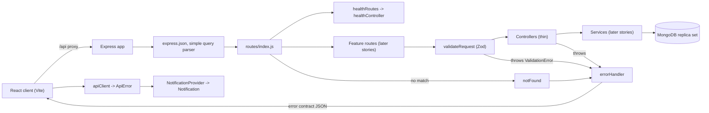
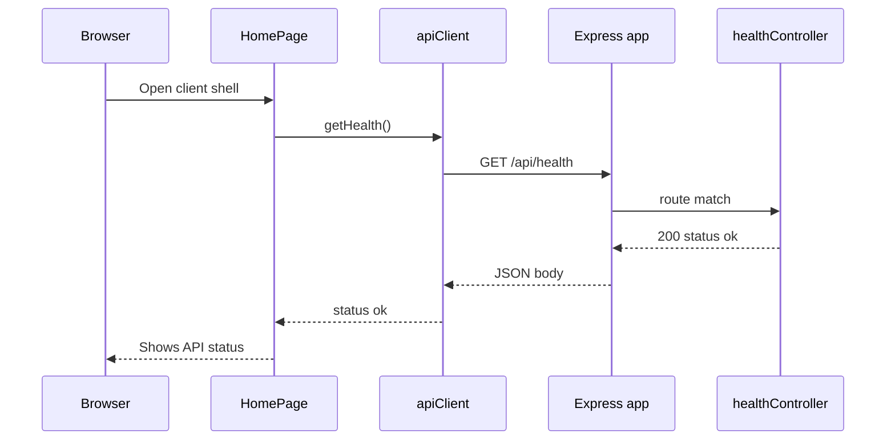

# WIPC-9: Project scaffolding and platform: Low-Level Design

## 1. Header

| Field | Value |
|---|---|
| Jira key | WIPC-9 (summary in Jira: `S-01: Project scaffolding and platform`) |
| Story label | S-01 in `docs/stories.md` |
| Size | M |
| Depends on | none |
| Parallel with | none listed (S-02 and S-08 and S-09 start after it) |
| Source documents | Jira WIPC-9, `docs/stories.md` (S-01), `docs/high-level-design.md` (sections 1, 2, 4, 5, 9, 11, 12), `shop_floor_resource_allocation_requirements.md` (FR-13, NFR-03, NFR-06, NFR-08, NFR-10), `.github/copilot-instructions.md` |
| Date | 2026-10-29 |

Key mapping used (read this first): Jira keys do not follow the `S-NN`
numbering. The Jira project lists WIPC-9 as `S-01`, WIPC-10 as `S-02`,
WIPC-20 as `S-08`, WIPC-14 as `S-09`, and so on. This LLD follows Jira
(WIPC-9 = S-01). The "same number" mapping in the prompt would have selected
S-09 (audit service), which is a different story. See open question OQ-01.

Dependent stories (Jira key = story label): WIPC-10 = S-02, WIPC-20 = S-08,
WIPC-14 = S-09. All build on this scaffold.

## 2. Story summary

Create the runnable skeleton so later stories can be built and tested: an
Express server with the agreed folder layout, environment-based
configuration, a MongoDB connection (replica set), a central error
middleware that implements the HLD error contract, a Zod request-validation
helper that rejects operator keys, a React shell with an API wrapper and a
notification component, test tooling that can open a MongoDB transaction,
lint and format rules, and a README.

In scope:

- Server and client skeletons, config loader, `.env.example`.
- Mongo connection, docker-compose replica set.
- Central error middleware, `ValidationError`, error contract.
- Zod validation helper with operator-key rejection.
- Client shell, routing, API service wrapper, notification component.
- Jest, Supertest, `mongodb-memory-server` replica set; Vitest and React
  Testing Library on the client.
- ESLint, Prettier, npm scripts `lint` and `test`; `README.md`.

Out of scope (other stories):

- Authentication, JWT, `authenticate`, `requireRole` (S-02).
- Any feature model, route or page (S-03 onward).
- `allocationValidation` rule functions (S-08).
- `auditService` and `AuditEvent` model (S-09).
- `withAllocationTransaction` (S-10). This story only proves that a
  transaction can be opened and rolled back.
- Hardening, production deployment, browser compatibility checks (S-22).

## 3. Requirements

### 3.1 Story acceptance criteria

| ID | Given / When / Then | SRS AC |
|---|---|---|
| WIPC9-AC1 | Given a fresh checkout and `.env` copied from `.env.example`, when the server starts, then `GET /api/health` returns 200 and the client shell loads. | None. Platform story; not in the AC-coverage table. Supports FR-13 and NFR-08. |
| WIPC9-AC2 | Given a thrown validation error in any controller, when the request completes, then the response follows the HLD error contract. | None. Implements FR-13 (HLD section 4). |
| WIPC9-AC3 | Given `npm test` is run, then Jest executes against an in-memory Mongo replica set and a transaction can be opened. | None. Enables NFR-03 and AC-06 (proven in S-14). |

### 3.2 Functional requirements

| ID | Requirement | Source |
|---|---|---|
| LLD-FR-01 | `GET /api/health` returns 200 with a small JSON body once the server is running. | WIPC9-AC1 |
| LLD-FR-02 | The React client shell (layout, routing, home page) loads and can reach the API. | WIPC9-AC1, sub-task `client/` |
| LLD-FR-03 | `server/` contains Express app, `routes`, `controllers`, `services`, `models`, `middleware` folders. | Sub-task 1, HLD section 2 |
| LLD-FR-04 | A config loader reads `MONGODB_URI`, `JWT_SECRET`, `PLANT_TIME_ZONE`, `PORT` (and `JWT_EXPIRES_IN`) from environment variables and fails fast when invalid. | Sub-task 2, HLD section 12 |
| LLD-FR-05 | `.env.example` lists every variable with placeholder values only. | Sub-task 2, deployment rules |
| LLD-FR-06 | The server connects to MongoDB; `docker-compose.yml` provides a single-node replica set for local development. | Sub-task 3, HLD section 5 |
| LLD-FR-07 | A central error middleware converts every thrown error to the HLD error contract (`error`, `failures[]` with `rule`, `message`, `fix`, `details`). Unknown routes return the same shape. | WIPC9-AC2, sub-task 4, FR-13 |
| LLD-FR-08 | A `ValidationError` type carries `failures[]` and an HTTP status (400, 403, 404, 409 or 422). | Sub-task 4, HLD section 4 |
| LLD-FR-09 | A Zod request-validation helper parses `body`, `query` and `params`, and rejects any key that starts with `$` or contains `.` (operator injection). | Sub-task 5, NFR-06 |
| LLD-FR-10 | The client has routing and an API service wrapper that turns error-contract responses into a typed `ApiError`. | Sub-task 6 |
| LLD-FR-11 | A notification component shows success messages and rule-failure lists (rule, message, fix) and never silently drops a failure. | Sub-task 6, FR-13 |
| LLD-FR-12 | Backend tests run with Jest and Supertest against a `mongodb-memory-server` replica set; a transaction can be opened, committed and aborted. | WIPC9-AC3, sub-task 7 |
| LLD-FR-13 | Client tests run with Vitest and React Testing Library. | Sub-task 7 |
| LLD-FR-14 | ESLint and Prettier enforce the coding standards; npm scripts `lint` and `test` exist at the root and per package. | Sub-task 8 |
| LLD-FR-15 | `README.md` documents setup, run and test steps. | Sub-task 9, source documentation rules |

### 3.3 Non-functional requirements

| ID | Requirement | Source |
|---|---|---|
| LLD-NFR-01 | Transactions must work in dev and test (replica set), so a failed change can leave no partial state. | NFR-03, HLD section 13, AC-03 of WIPC9 |
| LLD-NFR-02 | Validation and error handling live in one place (error middleware, validation helper) and are covered by automated tests. | NFR-08, story rules |
| LLD-NFR-03 | All input is validated on the server; the helper blocks NoSQL operator injection. | NFR-06, OWASP A03 |
| LLD-NFR-04 | No secrets in code; configuration only through environment variables; only `.env.example` is committed; error responses never expose stack traces or internals. | Deployment and sensitive-information rules, OWASP A05 |
| LLD-NFR-05 | Logs must not contain personal data, request bodies, tokens or secret values. | NFR-10 |
| LLD-NFR-06 | The error contract is uniform for 400, 403, 404, 409, 422 and 500 responses. | Story rules (error contract), FR-13 |
| LLD-NFR-07 | Code follows camelCase, 2 spaces, semicolons, single quotes, lines under 80 characters, async/await; enforced by lint. | Coding standards |
| LLD-NFR-08 | Tests and lint must pass before merge; `npm test` and `npm run lint` return a non-zero code on failure. | Deployment instructions |
| LLD-NFR-09 | Timestamps in responses are UTC ISO-8601; the plant time zone is validated at startup. | BR-11, HLD section 9 |

### 3.4 Constraints and assumptions

- Stack: React, Node.js (CommonJS on the server, matching the unit test
  example in the project instructions), Express 5, Mongoose, Zod, luxon,
  MongoDB replica set.
- Assumed Node.js 20 LTS or newer and npm workspaces with a root
  `package.json` (workspaces `server` and `client`).
- Client built with Vite; Vitest is used for client tests.
- No collections or indexes are created in this story.
- `GET /api/health` is a public route. HLD says all routes require
  authentication, but authentication does not exist yet and AC1 requires 200
  without credentials (OQ-02).
- `.env` and `.env.example` live at the repository root.
- Not in the HLD rule list but needed by the platform: rule codes
  `INVALID_INPUT`, `NOT_FOUND`, `INTERNAL_ERROR` (OQ-04).

## 4. Design overview



Layers touched: app bootstrap, config, db connection, route, controller,
middleware (validation, not found, error), error types, client shell,
client service wrapper, client notification component, test and tooling
setup.

## 5. Data design

Not applicable: this story creates no collections, schemas, indexes or
migrations. The test suite defines a throwaway `Probe` model inside the
transaction smoke test only (never exported or shipped).

Mongoose global settings applied at connection time:

- `mongoose.set('sanitizeFilter', true)`: defense in depth against operator
  objects in filters.
- `mongoose.set('strictQuery', true)`.

## 6. API design

### 6.1 `GET /api/health`

| Item | Value |
|---|---|
| Roles allowed | Public (no authentication). See OQ-02 |
| Request schema | No body, no query, no params. Unknown query keys are ignored |
| Status codes | 200 on success; 500 error contract if the handler throws |
| Errors | None expected |

Response 200:

```json
{
  "status": "ok",
  "timestamp": "2026-10-29T10:15:30.123Z"
}
```

The body exposes no configuration, version or database detail.

### 6.2 Shared error responses (apply to every route)

| Case | Status | Body `error` | `failures[].rule` |
|---|---|---|---|
| Thrown `ValidationError` | 400, 403, 404, 409 or 422 (set by thrower) | `ValidationError` | Rule code from the thrower |
| Invalid JSON body | 400 | `ValidationError` | `INVALID_INPUT` |
| Unknown route | 404 | `ValidationError` | `NOT_FOUND` |
| Unexpected error | 500 | `InternalError` | `INTERNAL_ERROR` |

Example 422 response (shape from HLD section 4):

```json
{
  "error": "ValidationError",
  "failures": [
    {
      "rule": "MATERIAL_INSUFFICIENT",
      "message": "Material M-10 has 15 available, 20 required.",
      "fix": "Reduce the quantity or increase stock.",
      "details": { "available": 15, "required": 20 }
    }
  ]
}
```

Example 400 response for an operator injection attempt
(`{ "operatorId": { "$ne": null } }`):

```json
{
  "error": "ValidationError",
  "failures": [
    {
      "rule": "INVALID_INPUT",
      "message": "body.operatorId.$ne: operator keys are not allowed.",
      "fix": "Send plain values only; remove keys that start with $.",
      "details": { "path": "body.operatorId.$ne" }
    }
  ]
}
```

Example 500 response:

```json
{
  "error": "InternalError",
  "failures": [
    {
      "rule": "INTERNAL_ERROR",
      "message": "The server could not complete the request.",
      "fix": "Try again. If the problem continues, contact support."
    }
  ]
}
```

## 7. Service and business logic

This story has no allocation, status or audit logic. Rules below are
platform rules.

### 7.1 Modules and signatures

| Module | Function or class | Params | Returns | Throws |
|---|---|---|---|---|
| `server/src/config/index.js` | `loadConfig(env)` | `env` object, default `process.env` | frozen `{ nodeEnv, mongodbUri, jwtSecret, jwtExpiresIn, plantTimeZone, port }` | `Error` naming invalid variables (never values) |
| `server/src/config/db.js` | `connectDb(uri)` | Mongo URI | resolved connection | driver error |
| `server/src/config/db.js` | `disconnectDb()` | none | resolved void | none |
| `server/src/errors/ValidationError.js` | `new ValidationError(failures, status)` | `failures[]`, status default 422 | error with `name`, `status`, `failures` | `TypeError` if status not allowed or `failures` empty |
| `server/src/middleware/validateRequest.js` | `validateRequest(schemas)` | `{ body?, query?, params? }` Zod schemas | Express middleware; sets `req.validated` | `ValidationError` (400) |
| `server/src/middleware/validateRequest.js` | `findOperatorKeys(value, path)` | any parsed JSON value, base path | array of offending paths | none |
| `server/src/middleware/notFound.js` | `notFound(req, res, next)` | Express args | none | passes `ValidationError` (404) to `next` |
| `server/src/middleware/errorHandler.js` | `errorHandler(err, req, res, next)` | Express args | JSON response | none |
| `server/src/app.js` | `createApp()` | none | configured Express app (no listen) | none |
| `server/src/server.js` | bootstrap | none | listens on `config.port` | exits with code 1 on config or DB failure |
| `server/src/controllers/healthController.js` | `getHealth(req, res)` | Express args | 200 JSON | none |

`failure` object: `{ rule, message, fix, details? }`.

Allowed `ValidationError` statuses: 400, 403, 404, 409, 422 (HLD lists
400, 403, 409, 422; 404 is added for unknown routes, OQ-04).

### 7.2 Evaluation order for each request

1. `express.json({ limit: '100kb' })` parses the body; a parse error becomes
   `INVALID_INPUT` (400) in `errorHandler`.
2. Router matches the route; no match goes to `notFound` (404).
3. (Later stories) `authenticate`, then `requireRole`.
4. `validateRequest`: first `findOperatorKeys` on body, query and params
   (any key starting with `$` or containing `.`, or named `__proto__`),
   then the Zod schema parse. All failures are collected, then thrown as one
   `ValidationError` (400).
5. Controller calls the service layer (rules stay in `allocationValidation`,
   S-08).
6. Any thrown error goes to `errorHandler`.

### 7.3 Pseudocode

Config loader:

```js
const envSchema = z.object({
  NODE_ENV: z.enum(['development', 'test', 'production'])
    .default('development'),
  MONGODB_URI: z.string().min(1),
  JWT_SECRET: z.string().min(32),
  JWT_EXPIRES_IN: z.string().min(1).default('1h'),
  PLANT_TIME_ZONE: z.string().refine((zone) => IANAZone.isValidZone(zone)),
  PORT: z.coerce.number().int().min(1).max(65535).default(3000),
});

function loadConfig(env = process.env) {
  const result = envSchema.safeParse(env);
  if (!result.success) {
    const names = [...new Set(result.error.issues.map((i) => i.path[0]))];
    throw new Error(`Invalid configuration: ${names.join(', ')}`);
  }
  const value = result.data;
  return Object.freeze({
    nodeEnv: value.NODE_ENV,
    mongodbUri: value.MONGODB_URI,
    jwtSecret: value.JWT_SECRET,
    jwtExpiresIn: value.JWT_EXPIRES_IN,
    plantTimeZone: value.PLANT_TIME_ZONE,
    port: value.PORT,
  });
}
```

`dotenv` is loaded only in `server.js` (root `.env`), never inside
`loadConfig`, so tests pass an explicit env object.

Validation helper:

```js
function findOperatorKeys(value, path) {
  if (Array.isArray(value)) {
    return value.flatMap((item, i) => findOperatorKeys(item, `${path}.${i}`));
  }
  if (value !== null && typeof value === 'object') {
    return Object.entries(value).flatMap(([key, child]) => {
      const here = `${path}.${key}`;
      const bad = key.startsWith('$') || key.includes('.')
        || key === '__proto__';
      return bad ? [here] : findOperatorKeys(child, here);
    });
  }
  return [];
}

function validateRequest(schemas) {
  return (req, res, next) => {
    const failures = [];
    const validated = {};
    for (const part of ['body', 'query', 'params']) {
      for (const path of findOperatorKeys(req[part], part)) {
        failures.push(operatorKeyFailure(path));
      }
      if (schemas[part]) {
        const result = schemas[part].safeParse(req[part]);
        if (result.success) validated[part] = result.data;
        else failures.push(...result.error.issues.map(toFailure(part)));
      }
    }
    if (failures.length > 0) return next(new ValidationError(failures, 400));
    req.validated = validated;
    return next();
  };
}
```

Schemas should use `z.strictObject` so unknown keys (including the literal
`id[$ne]` key the simple query parser produces) fail with `INVALID_INPUT`.
`req.validated` is used because `req.query` is read-only in Express 5.

Error handler:

```js
function errorHandler(err, req, res, next) {
  if (err instanceof ValidationError) {
    return res.status(err.status).json({
      error: 'ValidationError',
      failures: err.failures,
    });
  }
  if (err.type === 'entity.parse.failed') {
    const failure = {
      rule: 'INVALID_INPUT',
      message: 'The request body is not valid JSON.',
      fix: 'Send a well-formed JSON body.',
    };
    return res.status(400).json({ error: 'ValidationError', failures: [failure] });
  }
  console.error(err.name, err.message, err.stack);
  return res.status(500).json({ error: 'InternalError', failures: [{ ... }] });
}
```

Only `name`, `message` and `stack` are logged (never `req.body`, headers or
tokens, LLD-NFR-05). `server.js` bootstrap:

```js
async function start() {
  const config = loadConfig();
  await connectDb(config.mongodbUri);
  const server = createApp().listen(config.port);
  const stop = async () => {
    server.close();
    await disconnectDb();
  };
  process.on('SIGTERM', stop);
  process.on('SIGINT', stop);
}
start().catch((err) => {
  console.error(err.message);
  process.exit(1);
});
```

### 7.4 Transactions, concurrency, audit

- No allocation is touched, so no audit event is written and no version
  guard exists here.
- Transaction boundary: provided by the platform only. The test proves
  `session.withTransaction` commits, and that a thrown error leaves no
  document. `withAllocationTransaction` (HLD section 5) is built in S-10.
- Docker replica set (`docker-compose.yml`):

```yaml
services:
  mongo:
    image: mongo:7
    command: ['--replSet', 'rs0', '--bind_ip_all']
    ports: ['27017:27017']
    volumes: ['mongoData:/data/db']
    healthcheck:
      test: >-
        mongosh --quiet --eval
        "try { rs.status().ok }
        catch (e) { rs.initiate({_id:'rs0',members:[{_id:0,
        host:'localhost:27017'}]}).ok }"
      interval: 5s
      retries: 20
volumes:
  mongoData:
```

`.env.example` (placeholders only):

```
NODE_ENV=development
PORT=3000
MONGODB_URI=mongodb://localhost:27017/shopfloor?replicaSet=rs0
JWT_SECRET=replace-with-a-long-random-secret-value
JWT_EXPIRES_IN=1h
PLANT_TIME_ZONE=Asia/Kolkata
```

## 8. Sequence diagrams

Success: health check from the client shell.



Failure: validation error reaches the user as a rule list.

```mermaid
sequenceDiagram
  participant U as Browser
  participant A as apiClient
  participant E as Express app
  participant V as validateRequest
  participant X as errorHandler
  participant N as Notification
  U->>A: Submit form
  A->>E: POST /api/example with bad body
  E->>V: run validation
  V-->>X: next ValidationError status 400
  X-->>A: 400 error contract JSON
  A-->>U: throws ApiError with failures
  U->>N: notifyError(ApiError)
  N-->>U: Shows rule, message and fix; stays until dismissed
```

## 9. Error handling

| Rule code | HTTP | Message template | Fix template |
|---|---|---|---|
| `INVALID_INPUT` | 400 | `{path}: {zodMessage}` or `{path}: operator keys are not allowed.` or `The request body is not valid JSON.` | `Correct {path} and resubmit.` / `Send plain values only; remove keys that start with $.` / `Send a well-formed JSON body.` |
| `NOT_FOUND` | 404 | `No route matches {method} {path}.` | `Check the URL.` |
| `INTERNAL_ERROR` | 500 | `The server could not complete the request.` | `Try again. If the problem continues, contact support.` |
| `INVALID_TIME_WINDOW`, `RESOURCE_INACTIVE`, `SKILL_MISMATCH`, `CAPABILITY_MISMATCH`, `TIME_CONFLICT`, `MATERIAL_INSUFFICIENT`, `WORK_ORDER_CLOSED`, `INVALID_TRANSITION`, `FORBIDDEN` | 400, 403, 409 or 422 | Defined by the owning story | Defined by the owning story |

HTTP status per HLD rule code is not fixed in the HLD (OQ-03). This story
provides the mechanism: the thrower chooses the status when creating the
`ValidationError`.

Startup errors: invalid configuration prints
`Invalid configuration: <variable names>` (no values) and exits with code 1;
a failed Mongo connection prints the driver message and exits with code 1.

## 10. Client design

Structure under `client/src/`:

| File | Purpose |
|---|---|
| `main.jsx` | Mounts `App` inside `BrowserRouter` and `NotificationProvider` |
| `App.jsx` | Route table: `/` to `HomePage`, `*` to `NotFoundPage` |
| `components/AppShell.jsx` | Header, navigation, `Outlet`, notification area |
| `components/Notification.jsx` | Presentational message or failure list |
| `components/NotificationProvider.jsx` | Context with `notifySuccess`, `notifyError`, `dismiss`; exports `useNotification` |
| `pages/HomePage.jsx` | Shows API status from `getHealth()` |
| `pages/NotFoundPage.jsx` | Unknown client route |
| `services/apiClient.js` | `request(method, path, body)`, `ApiError` |
| `services/healthService.js` | `getHealth()` |

State: the notification provider holds one current notification
(`{ type, message, failures }`). A new notification replaces the old one;
nothing is cleared by a timer.

API wrapper (`apiClient.js`):

- Base URL `/api`; Vite dev server proxies `/api` to `http://localhost:3000`
  (`vite.config.js`).
- Sends and expects JSON.
- Non-2xx with an error-contract body throws
  `ApiError { status, error, failures }`.
- Network failure or non-JSON body throws `ApiError` with one local failure
  `{ rule: 'NETWORK_ERROR', message: 'Could not reach the server.', fix:
  'Check your connection and try again.' }`. This is a client display code,
  not a business rule.
- Leaves a single hook for the auth header (added in S-02).

Error display (`Notification`):

- `type: 'success'`: `role='status'`, message only.
- `type: 'error'`: `role='alert'`, heading message, then a list; each item
  shows the rule code, the message, and `Fix: <fix>`.
- Has a Dismiss button; error notifications stay until dismissed (FR-13: no
  silent discard). Form data is kept by the calling page on failure.
- No rule evaluation exists on the client; it renders server output only.

## 11. Security

- Authentication and role checks: not implemented here (S-02). The route
  index mounts `/health` before the future `authenticate` middleware, so every
  later route is protected by default once S-02 adds it (OQ-02).
- Input sanitization: `validateRequest` rejects `$`-prefixed, dotted and
  `__proto__` keys on body, query and params; query parser is `simple`
  (no nested objects); schemas use `z.strictObject`; Mongoose
  `sanitizeFilter` is on (NFR-06, OWASP A03).
- Request body size limited to 100 kb.
- Configuration: only from environment; `JWT_SECRET` must be at least
  32 characters; the loader never echoes values; `.env` is git-ignored and
  never read by tooling, only `.env.example` is committed (OWASP A05).
- Error responses never include stack traces, SQL or driver messages.
- Logging: no request bodies, headers, tokens or user fields (NFR-10).
- Dependencies are pinned through the lockfile; `npm audit` is part of S-22.

## 12. Test design

| ID | Test | Layer | Covers |
|---|---|---|---|
| T-01 | `GET /api/health` returns 200 and `status: 'ok'` without credentials | Supertest | WIPC9-AC1, LLD-FR-01 |
| T-02 | Health body contains only `status` and `timestamp` | Supertest | LLD-NFR-04 |
| T-03 | Unknown route returns 404 with contract shape and `NOT_FOUND` | Supertest | WIPC9-AC2, LLD-FR-07, LLD-NFR-06 |
| T-04 | Controller throws `ValidationError`; response has status, `error`, `failures[].rule/message/fix/details` | Supertest | WIPC9-AC2, LLD-FR-07, LLD-FR-08 |
| T-05 | Invalid JSON body returns 400 `INVALID_INPUT` | Supertest | LLD-FR-07 |
| T-06 | Unexpected error returns 500 `INTERNAL_ERROR`; body has no stack or message leak | Supertest | LLD-NFR-04, LLD-NFR-06 |
| T-07 | `ValidationError` rejects a disallowed status and empty failures | Unit | LLD-FR-08 |
| T-08 | `validateRequest` passes valid input into `req.validated`; invalid input returns all failures with paths | Unit and Supertest | LLD-FR-09 |
| T-09 | Body `{ "id": { "$ne": null } }` is rejected with 400 | Supertest | LLD-FR-09, LLD-NFR-03 |
| T-10 | Nested and array operator keys, dotted keys and `__proto__` are found by `findOperatorKeys` | Unit | LLD-FR-09, LLD-NFR-03 |
| T-11 | Query `?id[$ne]=x` is rejected (strict schema, simple parser) | Supertest | LLD-FR-09, LLD-NFR-03 |
| T-12 | `loadConfig` returns a frozen camelCase object for valid env and applies defaults | Unit | LLD-FR-04 |
| T-13 | `loadConfig` rejects missing `MONGODB_URI`, short `JWT_SECRET`, bad time zone, bad port; message lists names, not values | Unit | LLD-FR-04, LLD-NFR-04, LLD-NFR-09 |
| T-14 | `.env.example` contains every variable and `loadConfig` accepts it | Unit | LLD-FR-05, LLD-NFR-04 |
| T-15 | In-memory replica set is running (`hello` reports `setName`) | Integration | WIPC9-AC3, LLD-FR-12 |
| T-16 | Transaction commit persists a document | Integration | WIPC9-AC3, LLD-NFR-01 |
| T-17 | Transaction abort leaves no document | Integration | WIPC9-AC3, LLD-NFR-01 |
| T-18 | `npm run lint` passes on a clean tree and fails on a rule violation | CI check | LLD-FR-14, LLD-NFR-07, LLD-NFR-08 |
| T-19 | `AppShell` renders navigation and the routed page | React Testing Library | WIPC9-AC1, LLD-FR-02 |
| T-20 | `HomePage` shows API status from a mocked `getHealth` and an error notification on failure | React Testing Library | WIPC9-AC1, LLD-FR-02 |
| T-21 | `apiClient` returns JSON on 200, throws `ApiError` with failures on contract errors, and `NETWORK_ERROR` on network failure | Vitest unit | LLD-FR-10 |
| T-22 | `Notification` renders a failure list with rule, message and fix, `role='alert'` | React Testing Library | LLD-FR-11 |
| T-23 | `Notification` renders a success message with `role='status'` | React Testing Library | LLD-FR-11 |
| T-24 | Error notification stays until dismissed; a new one replaces the old | React Testing Library | LLD-FR-11 |
| T-25 | `NotFoundPage` renders for an unknown client route | React Testing Library | LLD-FR-02 |
| T-26 | README lists setup, run, test, docker and variable steps (manual review) | Review | LLD-FR-15 |
| T-27 | Folder layout and `docker-compose up` start a replica set, and `npm run dev` serves health through the client proxy (manual smoke on a fresh checkout) | Manual | WIPC9-AC1, LLD-FR-03, LLD-FR-06 |

Coverage check: WIPC9-AC1 by T-01, T-19, T-20, T-27; WIPC9-AC2 by T-03 and
T-04; WIPC9-AC3 by T-15 to T-17.

## 13. Implementation plan

1. [ ] Root: `package.json` (workspaces, scripts `lint`, `test`, `format`),
   `.gitignore` (`node_modules`, `.env`, `dist`, `coverage`), `.env.example`,
   `docker-compose.yml`, ESLint flat config and `.prettierrc`
   (`singleQuote`, `semi`, `tabWidth: 2`, `printWidth: 80`; ESLint rules for
   indent, semi, quotes, max-len, camelcase). Sub-tasks 3 and 8.
2. [ ] `server/package.json`, `jest.config.js` (node environment, longer
   timeout for first binary download, match `src/**/*.test.js` and
   `tests/**/*.test.js`). Sub-task 1 and 7.
3. [ ] `server/src/config/index.js` and `config/db.js`; tests T-12 to T-14.
   Sub-tasks 2 and 3.
4. [ ] `server/src/errors/ValidationError.js`; test T-07. Sub-task 4.
5. [ ] `server/src/middleware/errorHandler.js`, `notFound.js`; tests T-03 to
   T-06. Sub-task 4.
6. [ ] `server/src/middleware/validateRequest.js`; tests T-08 to T-11.
   Sub-task 5.
7. [ ] `server/src/controllers/healthController.js`,
   `routes/healthRoutes.js`, `routes/index.js`, `app.js`, `server.js`;
   tests T-01, T-02. Sub-task 1.
8. [ ] `server/tests/helpers/testDb.js` (start, stop, clear using
   `MongoMemoryReplSet`) and `server/tests/transaction.test.js`; tests
   T-15 to T-17. Sub-task 7.
9. [ ] `client/` Vite React app: `package.json`, `vite.config.js` (proxy,
   Vitest jsdom config), `index.html`, `src/main.jsx`, `App.jsx`. Sub-task 6.
10. [ ] `client/src/services/apiClient.js`, `healthService.js`; test T-21.
    Sub-task 6.
11. [ ] `client/src/components/Notification.jsx`,
    `NotificationProvider.jsx`, `AppShell.jsx`; `pages/HomePage.jsx`,
    `NotFoundPage.jsx`; tests T-19, T-20, T-22 to T-25. Sub-task 6 and 7.
12. [ ] Run `npm run lint` and `npm test` at the root; confirm T-18.
    Sub-task 8.
13. [ ] `README.md`: prerequisites, setup (`cp .env.example .env`,
    `docker compose up -d`), run, test, lint, layout, known limitations;
    T-26 and T-27. Sub-task 9.

## 14. Traceability matrix

| Requirement | Story AC | SRS AC | Design element | Test |
|---|---|---|---|---|
| LLD-FR-01 | WIPC9-AC1 | None | `healthController`, section 6.1 | T-01, T-02 |
| LLD-FR-02 | WIPC9-AC1 | None | Client shell, section 10 | T-19, T-20, T-25 |
| LLD-FR-03 | WIPC9-AC1 | None | Folder layout, section 13 | T-27 |
| LLD-FR-04 | WIPC9-AC1 | None | `loadConfig`, section 7.3 | T-12, T-13 |
| LLD-FR-05 | WIPC9-AC1 | None | `.env.example`, section 7.4 | T-14 |
| LLD-FR-06 | WIPC9-AC1, WIPC9-AC3 | None | `connectDb`, docker-compose | T-15, T-27 |
| LLD-FR-07 | WIPC9-AC2 | None (FR-13) | `errorHandler`, `notFound` | T-03 to T-05 |
| LLD-FR-08 | WIPC9-AC2 | None (FR-13) | `ValidationError` | T-04, T-07 |
| LLD-FR-09 | WIPC9-AC2 | None (NFR-06) | `validateRequest`, `findOperatorKeys` | T-08 to T-11 |
| LLD-FR-10 | WIPC9-AC2 | None | `apiClient`, `ApiError` | T-21 |
| LLD-FR-11 | WIPC9-AC2 | None (FR-13) | `Notification`, `NotificationProvider` | T-22 to T-24 |
| LLD-FR-12 | WIPC9-AC3 | None | `testDb.js`, `MongoMemoryReplSet` | T-15 to T-17 |
| LLD-FR-13 | WIPC9-AC1 | None | Vitest config, client tests | T-19 to T-25 |
| LLD-FR-14 | WIPC9-AC3 | None | ESLint, Prettier, scripts | T-18 |
| LLD-FR-15 | WIPC9-AC1 | None | `README.md` | T-26 |
| LLD-NFR-01 (NFR-03) | WIPC9-AC3 | None (enables AC-06) | docker-compose, test replica set | T-16, T-17 |
| LLD-NFR-02 (NFR-08) | WIPC9-AC2 | None | Single error and validation modules | T-03 to T-11 |
| LLD-NFR-03 (NFR-06) | WIPC9-AC2 | None | `findOperatorKeys`, strict schemas, `sanitizeFilter` | T-09 to T-11 |
| LLD-NFR-04 | WIPC9-AC1, WIPC9-AC2 | None | Config loader, error handler, `.env.example` | T-02, T-06, T-13, T-14 |
| LLD-NFR-05 (NFR-10) | WIPC9-AC2 | None | Logging limits in `errorHandler` | T-06 (no leak), review |
| LLD-NFR-06 | WIPC9-AC2 | None | Error contract, section 6.2 | T-03 to T-06 |
| LLD-NFR-07 | WIPC9-AC1 | None | ESLint and Prettier config | T-18 |
| LLD-NFR-08 | WIPC9-AC3 | None | npm scripts return non-zero on failure | T-18 |
| LLD-NFR-09 (BR-11) | WIPC9-AC1 | None | `PLANT_TIME_ZONE` check, UTC timestamps | T-13, T-01 |

## 15. Open questions and risks

| ID | Item |
|---|---|
| OQ-01 | Key mapping conflict. The prompt assumes `WIPC-NN` = `S-NN`, but Jira has WIPC-9 = S-01 (and WIPC-1 to WIPC-8 are unrelated embedded-controller stories such as `US-045`). Confirm the Jira keys should be written into `docs/stories.md`; until then use the Jira summary as the source of truth. The prompt text that calls WIPC-09 an audit story is also stale. |
| OQ-02 | HLD section 10 says all routes require authentication; AC1 needs `GET /api/health` to return 200 and S-02 does not exist yet. Assumed public. Confirm it stays public after S-02. |
| OQ-03 | HLD does not map rule codes to HTTP statuses (400, 403, 409, 422). Proposed default 422 for business rules, 400 for malformed input, 403 for `FORBIDDEN`, 409 for conflicts (`TIME_CONFLICT`). Confirm. |
| OQ-04 | `INVALID_INPUT`, `NOT_FOUND`, `INTERNAL_ERROR` and status 404 are not in the HLD rule list. Confirm and add to the HLD. |
| OQ-05 | Health is liveness only. Should it report database connectivity and return 503 when Mongo is down? |
| OQ-06 | `withAllocationTransaction` is assumed to belong to S-10 (HLD section 5); S-01 only proves transactions. Confirm. |
| OQ-07 | Assumed npm workspaces monorepo, Express 5 (async errors reach `errorHandler` natively; Express 4 would need a wrapper), Vite and Vitest for the client, Node 20 or newer, Mongo 7. Confirm tooling versions. |
| OQ-08 | Production serving of the client, CORS and security headers (for example `helmet`) are not in the story. Dev uses a Vite proxy, so no CORS is configured. Defer to S-22 or add a story. |
| OQ-09 | PascalCase component file names are not enforced by lint; enforced in review unless a filename lint rule is added. |
| OQ-10 | Risk: the first `mongodb-memory-server` run downloads a MongoDB binary (slow, needs network). Mitigation: cache the binary in CI and pin `MONGOMS_VERSION`. |
| OQ-11 | Risk: docker replica set uses `localhost:27017` as member host; it works for host-run apps but not for containerised apps on the same network. |
| OQ-12 | Jira WIPC-9 lists sub-tasks as bullets in the description, not as Jira sub-tasks (the issue has none). The Jira text is identical to `docs/stories.md` S-01, so no conflict. |
| OQ-13 | The story has no matching SRS acceptance criterion; the SRS AC-01 to AC-12 are proven in later stories. |
| OQ-14 | Common Zod field schemas (ids, quantities, ISO date times) are not created here; each feature story defines its own, or a later story extracts a shared module. |
