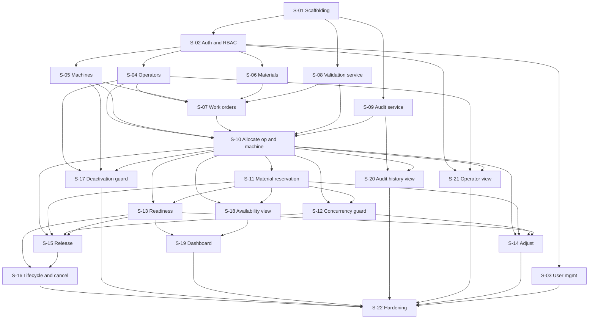

# Shop-Floor Resource Allocation System: Stories

Derived from `docs/high-level-design.md` (HLD) and the SRS. Story IDs below
refer to HLD sections by number.

## 1. Conventions

### Size legend (relative complexity, not time)

| Size | Meaning |
|---|---|
| S | One concern, few rules, small API and UI surface |
| M | Several rules or screens, or one non-trivial cross-layer concern |
| L | Transactional, multi-rule, multi-resource behavior; split into sub-tasks |

### Story rules

- Each story is a vertical slice (API, UI where applicable, tests) and is
  testable on its own once its listed dependencies are done.
- "Depends on" means the story cannot start or be tested without them.
  "Parallel with" means no ordering between them.
- Every story includes: input validation on the server, role checks, the
  error contract from HLD section 4, indexes for its own collections, and
  tests for its own acceptance criteria.
- Sub-tasks are checklist items inside a story, not separate stories.
- Code follows the project standards: camelCase, 2 spaces, semicolons,
  single quotes, lines under 80 characters, async/await.

## 2. Summary

| ID | Story | Size | Depends on | Parallel with | Requirements |
|---|---|---|---|---|---|
| S-01 | Project scaffolding and platform | M | none | | FR-13, NFR-03, NFR-08 |
| S-02 | Authentication and RBAC | M | S-01 | | NFR-04, NFR-10 |
| S-03 | Administrator user management | S | S-02 | S-04, S-05, S-06, S-08, S-09 | FR (Section 5) |
| S-04 | Operator management | M | S-02 | S-03, S-05, S-06, S-08, S-09 | FR-01, BR-01, NFR-06 |
| S-05 | Machine management | M | S-02 | S-03, S-04, S-06, S-08, S-09 | FR-01, BR-01, NFR-06 |
| S-06 | Material management | S | S-02 | S-03, S-04, S-05, S-08, S-09 | FR-02, BR-07, NFR-06 |
| S-07 | Work-order CRUD and requirements | M | S-04, S-05, S-06, S-08 | S-09 | FR-03, BR-01, BR-11 |
| S-08 | Shared validation service | M | S-01 | S-02 to S-06, S-09 | BR-02 to BR-05, BR-07, FR-06, NFR-08 |
| S-09 | Audit event service | S | S-01 | S-02 to S-08 | FR-12, BR-10, NFR-05 |
| S-10 | Allocate operators and machines | L | S-04, S-05, S-07, S-08, S-09 | | FR-05, FR-06, BR-08, AC-02 to AC-04, AC-09 |
| S-11 | Material reservation | M | S-10 | | FR-05, BR-06, BR-07, AC-05 |
| S-12 | Concurrency guard | M | S-10, S-11 | S-13 | FR-06, NFR-07, AC-11 |
| S-13 | Readiness and blocked reasons | M | S-10, S-11 | S-12 | FR-07, BR-09, AC-01, AC-08 |
| S-14 | Adjust allocation with rollback | L | S-10, S-11, S-12, S-13 | S-15 | FR-08, BR-08, AC-06 |
| S-15 | Release allocation | M | S-10, S-11, S-12, S-13 | S-14 | FR-09, BR-07, AC-07 |
| S-16 | Work-order lifecycle and cancellation | M | S-13, S-15 | S-14 | FR-10, BR-09, AC-12 |
| S-17 | Resource deactivation guard | S | S-04, S-05, S-10 | S-11 to S-16 | FR-01 |
| S-18 | Resource availability view | M | S-10, S-11 | S-12 to S-17 | FR-04 |
| S-19 | Allocation overview dashboard | M | S-13, S-18 | S-20, S-21 | FR-11 |
| S-20 | Audit history view | S | S-09, S-10 | S-19, S-21 | FR-12, AC-10 |
| S-21 | Operator own-assignments view | S | S-02, S-04, S-10 | S-19, S-20 | Section 5, AC-09 |
| S-22 | Hardening, documentation and traceability | M | S-01 to S-21 | | NFR-01, NFR-02, NFR-09, Section 15 |

## 3. Dependency graph

## 4. Suggested delivery order

| Wave | Stories | Notes |
|---|---|---|
| 1 | S-01 | Platform |
| 2 | S-02, S-08, S-09 | Parallel |
| 3 | S-03, S-04, S-05, S-06 | Parallel |
| 4 | S-07 | |
| 5 | S-10 | Longest story; start early |
| 6 | S-11 | |
| 7 | S-12, S-13 | Parallel |
| 8 | S-14, S-15, S-17, S-18, S-20, S-21 | Parallel |
| 9 | S-16, S-19 | |
| 10 | S-22 | |

## 5. Acceptance-criteria coverage

| AC | Proven in | Notes |
|---|---|---|
| AC-01 | S-13 | Needs S-10 and S-11 |
| AC-02 | S-10 | |
| AC-03 | S-10 | Also unit-tested in S-08 |
| AC-04 | S-10 | |
| AC-05 | S-11 | |
| AC-06 | S-14 | |
| AC-07 | S-15 | |
| AC-08 | S-13 | |
| AC-09 | S-10 | Route-level test; middleware comes from S-02 |
| AC-10 | S-20 | Needs S-10 for data |
| AC-11 | S-12 | |
| AC-12 | S-16 | |

---

## 6. Stories

### S-01: Project scaffolding and platform

- **Size:** M
- **Depends on:** none
- **Requirements:** FR-13, NFR-03, NFR-08, deployment and sensitive-data rules

**Description:** Create the runnable skeleton so later stories can be built
and tested: server, client, database connection, configuration, error
handling, test setup.

**Acceptance criteria**
- Given a fresh checkout and `.env` copied from `.env.example`, when the
  server starts, then `GET /api/health` returns 200 and the client shell
  loads.
- Given a thrown validation error in any controller, when the request
  completes, then the response follows the HLD error contract.
- Given `npm test` is run, then Jest executes against an in-memory Mongo
  replica set and a transaction can be opened.

**Sub-tasks**
- [ ] `server/` Express app, routes, controllers, services, models,
  middleware folders.
- [ ] Config loader from environment variables (`MONGODB_URI`, `JWT_SECRET`,
  `PLANT_TIME_ZONE`, `PORT`); `.env.example` with placeholders only.
- [ ] Mongo connection and docker-compose replica set for local development.
- [ ] Central error middleware, `ValidationError` type, error contract.
- [ ] Request validation helper (Zod) that rejects non-scalar operator keys.
- [ ] `client/` React app shell with routing, API service wrapper, and a
  notification component for success and rule-failure messages.
- [ ] Jest, Supertest, `mongodb-memory-server` replica set; Vitest or Jest
  with React Testing Library for the client.
- [ ] ESLint and Prettier rules matching the coding standards; npm scripts
  for `lint` and `test`.
- [ ] `README.md` with setup, run and test instructions.

**Test notes:** health route, error middleware shape, transaction smoke test,
notification component renders a failure list.

---

### S-02: Authentication and RBAC

- **Size:** M
- **Depends on:** S-01
- **Requirements:** NFR-04, NFR-10, section 5 roles

**Description:** Users log in and every API route is authenticated and
role-checked server-side.

**Acceptance criteria**
- Given valid credentials, when a user logs in, then a JWT is returned and
  `GET /api/auth/me` returns the user without `passwordHash`.
- Given no or an invalid token, when any protected route is called, then the
  response is 401.
- Given a role not permitted for a route, when it is called, then the
  response is 403 with rule `FORBIDDEN`.
- Given repeated failed logins from one source, then further attempts are
  rate limited.
- Given a deactivated user, when they log in, then login is rejected.

**Sub-tasks**
- [ ] `User` model: `userId`, `name`, `passwordHash`, `role`, `status`.
- [ ] bcrypt hashing; login controller and service.
- [ ] `authenticate` and `requireRole(...roles)` middleware.
- [ ] Login rate limiting; no personal data or tokens in logs.
- [ ] Seed script that creates the first Administrator from environment
  variables (no credentials in code).
- [ ] Login page, auth context, route guard in the client.

**Test notes:** 401, 403, rate limit, deactivated user, no hash in any
response, injection payloads such as `{ "$gt": "" }` rejected.

---

### S-03: Administrator user management

- **Size:** S
- **Depends on:** S-02
- **Parallel with:** S-04, S-05, S-06, S-08, S-09
- **Requirements:** section 5 (manage users and roles)

**Description:** Administrators create users, assign roles, and deactivate
users.

**Acceptance criteria**
- Given an Administrator, when they create a user with a valid role, then
  the user is stored with a hashed password.
- Given a non-Administrator, when they call user routes, then 403.
- Given a duplicate `userId`, then the request is rejected.
- Given a deactivated user, then existing tokens stop working on the next
  request.

**Sub-tasks**
- [ ] `GET/POST /users`, `PATCH /users/:id`.
- [ ] Admin users page (list, create, change role, deactivate).
- [ ] Unique index on `userId`.

**Test notes:** role gating, uniqueness, password never returned.

---

### S-04: Operator management

- **Size:** M
- **Depends on:** S-02
- **Parallel with:** S-03, S-05, S-06, S-08, S-09
- **Requirements:** FR-01, BR-01, NFR-06

**Description:** Administrators maintain operator records.

**Acceptance criteria**
- Given an Administrator, when they create an operator with unique ID, name,
  skills and status, then it is saved.
- Given a duplicate `operatorId`, then it is rejected (BR-01).
- Given an update or deactivation, then the change is saved and the operator
  is no longer eligible for new allocations.
- Given a Supervisor or Operator user, when they try to create or update,
  then 403; Supervisors may list and view.
- Given an operator linked to a user, then `userId` is stored and unique.

**Sub-tasks**
- [ ] `Operator` model: `operatorId`, `name`, `skills[]` (normalized),
  `status`, `userId?`, `version`; unique indexes.
- [ ] CRUD and deactivate endpoints with schema validation.
- [ ] Operator list and form pages.
- [ ] Skill normalization (trim, lowercase) helper.

**Note:** deactivation of an operator with active allocations is enforced by
S-17.

**Test notes:** uniqueness, normalization, role gating, invalid input.

---

### S-05: Machine management

- **Size:** M
- **Depends on:** S-02
- **Parallel with:** S-03, S-04, S-06, S-08, S-09
- **Requirements:** FR-01, BR-01, NFR-06

**Description:** Administrators maintain machine records.

**Acceptance criteria**
- Given an Administrator, when they create a machine with unique ID, name,
  capabilities and status, then it is saved.
- Given a duplicate `machineId`, then it is rejected.
- Given an update or deactivation, then the machine stops being eligible for
  new allocations.
- Given a non-Administrator, when they create or update, then 403.

**Sub-tasks**
- [ ] `Machine` model: `machineId`, `name`, `capabilities[]`, `status`,
  `version`; unique index.
- [ ] CRUD and deactivate endpoints.
- [ ] Machine list and form pages.
- [ ] Reuse the normalization helper from S-04, or extract it to a shared
  utility if S-05 is built first.

**Note:** guard for active allocations is S-17.

**Test notes:** same set as S-04.

---

### S-06: Material management

- **Size:** S
- **Depends on:** S-02
- **Parallel with:** S-03, S-04, S-05, S-08, S-09
- **Requirements:** FR-02, BR-07, NFR-06

**Description:** Maintain materials and their stock.

**Acceptance criteria**
- Given an Administrator, when they create a material with unique ID, name,
  unit and on-hand quantity, then it is saved with `reservedQuantity` 0.
- Given a negative quantity, then the request is rejected.
- Given a Supervisor or Administrator, when they set stock below the
  currently reserved quantity, then it is rejected naming both numbers.
- Given any other role, then 403 for stock updates.

**Sub-tasks**
- [ ] `Material` model with `onHandQuantity`, `reservedQuantity`, derived
  `availableQuantity`; unique index.
- [ ] `POST/GET/PATCH /materials`, `PUT /materials/:id/stock`.
- [ ] Materials page with stock edit.

**Test notes:** negative quantity, stock below reserved, derived value.

---

### S-07: Work-order CRUD and requirements

- **Size:** M
- **Depends on:** S-04, S-05, S-06, S-08
- **Parallel with:** S-09
- **Requirements:** FR-03, BR-01, BR-11

**Description:** Supervisors and Administrators create and maintain work
orders with their requirements. New work orders start in `Draft`.

**Acceptance criteria**
- Given valid data, when a work order is created, then it is saved as Draft
  with times stored in UTC from the plant time zone.
- Given `plannedEnd <= plannedStart`, then the request is rejected with
  `INVALID_TIME_WINDOW`.
- Given a duplicate `workOrderId`, then it is rejected.
- Given a requirement referencing an unknown `materialId`, then it is
  rejected.
- Given `operatorCount` or `machineCount` missing, then each defaults to 1.
- Given an Operator user, then create and update return 403.

**Sub-tasks**
- [ ] `WorkOrder` model and requirement subdocument; unique index.
- [ ] Create, list, get, update endpoints; plant-zone to UTC conversion.
- [ ] Use `isValidWindow` from S-08.
- [ ] Work-order list, create and edit pages.

**Note:** the rule that rejects a window change when active allocations exist
is wired in S-10, when allocations first exist. Cancel and status changes are
in S-16.

**Test notes:** zero-length window, time zone round trip, defaults, unknown
material.

---

### S-08: Shared validation service

- **Size:** M
- **Depends on:** S-01
- **Parallel with:** S-02 to S-06, S-09
- **Requirements:** BR-02 to BR-05, BR-07, FR-03, FR-06, NFR-08

**Description:** Implement the pure rule functions in
`server/src/services/allocationValidation.js` per HLD section 4. No database
access.

**Acceptance criteria**
- Given overlapping windows 09:00 to 11:00 and 10:00 to 12:00, then
  `hasOverlap` is true (AC-02 rule).
- Given back-to-back windows 09:00 to 10:00 and 10:00 to 11:00, then it is
  false (AC-03 rule).
- Given `hasOverlap(a, b)`, then it equals `hasOverlap(b, a)`.
- Given an inactive operator or machine, then `isResourceActive` is false.
- Given a missing skill or capability, then the matching function is false
  and `validateAllocation` returns `SKILL_MISMATCH` or
  `CAPABILITY_MISMATCH`.
- Given 15 available and 20 required, then `checkMaterial` fails and reports
  both numbers.
- Given several failing checks, then `validateAllocation` returns all
  failures, not only the first.

**Sub-tasks**
- [ ] `isValidWindow`, `hasOverlap`, `isResourceActive`, `hasSkill`,
  `hasCapability`, `checkMaterial`, `validateAllocation`.
- [ ] Failure objects with `rule`, `message`, `fix`, `details`.
- [ ] Exhaustive unit tests (partial overlap, containment, adjacency,
  identical windows, invalid windows).

**Test notes:** pure unit tests only; follows the example in the project
instructions.

---

### S-09: Audit event service

- **Size:** S
- **Depends on:** S-01
- **Parallel with:** S-02 to S-08
- **Requirements:** FR-12, BR-10, NFR-05

**Description:** Append-only audit log service callable inside a transaction.
The actor is passed in as a parameter.

**Acceptance criteria**
- Given an event, when `record(session, event)` is called, then an entry with
  actor, action, work-order ID, before, after, timestamp and optional reason
  is stored.
- Given a transaction that aborts after `record`, then no audit entry
  remains.
- Given any attempt to update or delete an entry through the service or API,
  then it is not possible.

**Sub-tasks**
- [ ] `AuditEvent` model with index `{workOrderId, timestamp}`.
- [ ] `auditService.record` and `listByWorkOrder`.
- [ ] Schema hooks that reject update and delete operations.
- [ ] No update or delete route exists.

**Test notes:** rollback leaves no entry, modification attempts rejected,
timestamp set server-side.

---

### S-10: Allocate operators and machines

- **Size:** L
- **Depends on:** S-04, S-05, S-07, S-08, S-09
- **Requirements:** FR-05, FR-06, FR-13, BR-02 to BR-05, BR-08, NFR-03,
  AC-02, AC-03, AC-04, AC-09

**Description:** A Supervisor allocates one or more operators and machines
to a work order. Validation uses S-08, the save runs in one transaction, and
an audit event is written. Materials are accepted in the request shape but
enabled in S-11.

**Acceptance criteria**
- Given a qualified operator and compatible machine with no conflicts, when
  allocated, then active allocation rows are saved and an audit event
  `ALLOCATION_CREATED` is written (AC-01 partial).
- Given an operator already allocated 09:00 to 11:00, when allocated to
  another work order 10:00 to 12:00, then 409 with `TIME_CONFLICT` naming the
  conflicting work order and window; nothing is saved (AC-02).
- Given an operator allocated 09:00 to 10:00, when allocated 10:00 to 11:00,
  then it is allowed (AC-03).
- Given a machine lacking the required capability, then 422 with
  `CAPABILITY_MISMATCH` (AC-04).
- Given an inactive resource, then `RESOURCE_INACTIVE`.
- Given a Completed or Cancelled work order, then `WORK_ORDER_CLOSED`.
- Given several failing checks, then every failure is returned (FR-05).
- Given a failure after the first row is written, then no rows remain
  (BR-08).
- Given an Operator-role user, then 403 and nothing changes (AC-09).

**Sub-tasks**
- [ ] `Allocation` model and indexes.
- [ ] `allocationService.create` loads data, calls `validateAllocation`,
  re-checks conflicts inside a Mongo transaction, writes rows and audit
  event.
- [ ] `POST /work-orders/:id/allocations` with schema validation and
  `requireRole('supervisor')`.
- [ ] Wire the "reject planned window change when active allocations exist"
  rule into S-07 work-order update.
- [ ] Allocation form: pick active operators and machines, show every
  failed rule with its fix hint through the notification component.
- [ ] Success message on save (FR-13).
- [ ] Tests: each AC above, rollback with injected failure, role matrix.

**Test notes:** service-level tests for rules; Supertest for status codes and
role; rollback test forces an error mid-transaction.

---

### S-11: Material reservation

- **Size:** M
- **Depends on:** S-10
- **Requirements:** FR-05, BR-06, BR-07, AC-05

**Description:** Allocation requests may include material quantities, which
become reservations that reduce available stock.

**Acceptance criteria**
- Given 20 required and 15 available, when reserved, then 422 with
  `MATERIAL_INSUFFICIENT`, message showing available 15 and required 20, and
  stock is unchanged (AC-05).
- Given sufficient stock, when reserved, then `reservedQuantity` increases,
  a material allocation row with `quantity` is saved, and the audit event
  lists it.
- Given a failure after the reservation step, then the reservation is rolled
  back.
- Given a reservation that would make available stock negative, then it is
  rejected regardless of validation timing (BR-07).

**Sub-tasks**
- [ ] Conditional stock update in the transaction (reserve only when
  `onHandQuantity - reservedQuantity >= qty`).
- [ ] Extend `POST /work-orders/:id/allocations` and the form for materials.
- [ ] Extend the audit before/after snapshots for material rows.
- [ ] Tests: AC-05, rollback, exact-fit reservation, non-negative invariant.

**Test notes:** exact-fit (quantity equals available) succeeds; one more unit
fails.

---

### S-12: Concurrency guard

- **Size:** M
- **Depends on:** S-10, S-11
- **Parallel with:** S-13
- **Requirements:** FR-06, NFR-07, AC-11

**Description:** Extract and harden the transaction logic into
`withAllocationTransaction` so concurrent requests cannot bypass conflict or
stock checks. Used by S-10, S-11 and later stories.

**Acceptance criteria**
- Given two supervisors allocating the same machine to overlapping windows at
  the same time, then at most one allocation is committed and the other gets
  a `TIME_CONFLICT` response (AC-11).
- Given two requests reserving more material than available in total, then
  total reserved never exceeds on-hand stock.
- Given a transient write conflict, then the helper retries up to the
  configured limit and re-validates.

**Sub-tasks**
- [ ] `withAllocationTransaction(fn)`: session, retry on transient errors,
  re-validation inside the transaction.
- [ ] Bump `version` on each touched operator, machine and work order.
- [ ] Refactor S-10 and S-11 services onto the helper.
- [ ] Concurrency tests firing parallel requests (`Promise.all`) against the
  in-memory replica set.

**Test notes:** run the parallel test repeatedly in CI to catch flakiness.

---

### S-13: Readiness and blocked reasons

- **Size:** M
- **Depends on:** S-10, S-11
- **Parallel with:** S-12
- **Requirements:** FR-07, BR-09, AC-01, AC-08

**Description:** Compute readiness and persist work-order status. Includes
the Draft to Ready/Blocked "plan" action.

**Acceptance criteria**
- Given a Draft work order with all required operators, machines and
  materials allocated, when planned, then status is Ready (AC-01).
- Given a work order missing a required operator, when planned or viewed
  after allocation changes, then status is Blocked and `MISSING_OPERATOR` is
  listed (AC-08).
- Given an allocation change on a Ready or Blocked work order, then status is
  recalculated in the same transaction (BR-09).
- Given an In Progress work order, then allocation changes do not change its
  status.
- Given insufficient reserved material or an incompatible resource, then
  matching reasons are listed.

**Sub-tasks**
- [ ] `readinessService.evaluate(workOrder, allocations)` returning status
  and `blockedReasons[]`.
- [ ] `syncWorkOrderStatus(session, workOrderId)` called from the allocation
  services in S-10 and S-11.
- [ ] `POST /work-orders/:id/plan` and `GET /work-orders/:id/readiness`.
- [ ] Readiness panel on the work-order page listing reasons.
- [ ] Tests for each reason and each transition.

**Test notes:** counts respect `operatorCount` and `machineCount`.

---

### S-14: Adjust allocation with rollback

- **Size:** L
- **Depends on:** S-10, S-11, S-12, S-13
- **Parallel with:** S-15
- **Requirements:** FR-08, BR-08, NFR-03, AC-06

**Description:** Supervisors change an assigned operator, machine, material
quantity, or the work order's planned window. All changes are validated first
and applied atomically.

**Acceptance criteria**
- Given a valid current allocation, when a machine is replaced by an unavailable
  one, then the change is rejected, the original allocation is unchanged and
  the reason is shown (AC-06).
- Given a valid replacement, then the old row is released, the new row is
  active, the audit event stores before and after, and readiness is
  recalculated.
- Given a material quantity increase beyond available stock, then
  `MATERIAL_INSUFFICIENT` and no change.
- Given a decrease, then the difference returns to available stock.
- Given a planned-window change, then every active allocation is
  revalidated for conflicts and the change is rejected if any fails.
- Given a failure at any step, then no partial update persists.

**Sub-tasks**
- [ ] `allocationService.update` on `withAllocationTransaction`.
- [ ] `PATCH /allocations/:id` and window-change endpoint on the work order.
- [ ] Before/after snapshot builder for audit.
- [ ] Edit UI with a reason field and clear rejection messages.
- [ ] Tests: AC-06, each change type, rollback after injected failure,
  window revalidation.

**Test notes:** assert database state before and after rejected changes.

---

### S-15: Release allocation

- **Size:** M
- **Depends on:** S-10, S-11, S-12, S-13
- **Parallel with:** S-14
- **Requirements:** FR-09, BR-07, AC-07

**Description:** Supervisors release allocations that are no longer needed.

**Acceptance criteria**
- Given active operator and machine allocations, when released, then the rows
  become `released`, the resources are allocatable to non-conflicting work
  and an `ALLOCATION_RELEASED` audit event is written (AC-07).
- Given a material allocation, when released, then the reserved quantity is
  returned to available stock and never exceeds on-hand stock.
- Given a released allocation, when released again, then the request is
  rejected without changing stock.
- Given the release leaves requirements unmet, then readiness is
  recalculated.

**Sub-tasks**
- [ ] `allocationService.release` on `withAllocationTransaction`.
- [ ] `POST /allocations/:id/release` with optional reason.
- [ ] Release action in the work-order UI.
- [ ] Tests: AC-07, stock return, double release, readiness update.

---

### S-16: Work-order lifecycle and cancellation

- **Size:** M
- **Depends on:** S-13, S-15
- **Parallel with:** S-14
- **Requirements:** FR-10, BR-09, AC-12

**Description:** Enforce the status lifecycle and cancellation behavior from
HLD section 6.

**Acceptance criteria**
- Given a Blocked work order, when moved to In Progress, then rejected with
  `INVALID_TRANSITION` (FR-10).
- Given a Ready work order, when started and then completed, then each
  transition succeeds.
- Given a Completed or Cancelled work order, when an allocation is
  attempted, then `WORK_ORDER_CLOSED`.
- Given a work order with active allocations, when cancelled, then status is
  Cancelled, all active allocations are released, reserved material returns
  to stock and audit history is retained (AC-12).
- Given an invalid transition, then the state is unchanged.

**Sub-tasks**
- [ ] Transition table and `workOrderService.changeStatus`.
- [ ] `POST /work-orders/:id/status` and `POST /work-orders/:id/cancel`;
  cancel runs in one transaction using the release logic.
- [ ] Audit events for each released allocation, with a cancellation reason.
- [ ] Status action buttons in the UI, shown only when permitted.
- [ ] Tests: full transition matrix, AC-12, history retained.

---

### S-17: Resource deactivation guard

- **Size:** S
- **Depends on:** S-04, S-05, S-10
- **Parallel with:** S-11 to S-16
- **Requirements:** FR-01

**Description:** Prevent deactivating an operator or machine that has an
active allocation.

**Acceptance criteria**
- Given a resource with an active allocation, when deactivation is requested,
  then rejected with a message listing the work orders to release or
  reassign.
- Given the allocation is released, then deactivation succeeds.
- Given a resource without active allocations, then deactivation succeeds as
  before.

**Sub-tasks**
- [ ] Active-allocation lookup in the operator and machine services.
- [ ] Error with `RESOURCE_IN_USE` rule code and work-order list.
- [ ] Show the message in the admin UI.
- [ ] Tests for both resource types.

---

### S-18: Resource availability view

- **Size:** M
- **Depends on:** S-10, S-11
- **Parallel with:** S-12 to S-17
- **Requirements:** FR-04

**Description:** For a selected work order, show operators, machines and
materials with availability and overlaps.

**Acceptance criteria**
- Given a work order window, when the view loads, then every operator and
  machine shows status and any existing allocation overlapping that window.
- Given back-to-back allocations, then they are not shown as overlapping.
- Given a material, then available quantity and the work order's required
  quantity are shown side by side.
- Given a non-Supervisor, non-Administrator user, then 403.

**Sub-tasks**
- [ ] `GET /work-orders/:id/availability` using `hasOverlap`.
- [ ] Availability page or panel, reusable by the allocation form.
- [ ] Tests: overlap, adjacency, inactive resources, material figures.

---

### S-19: Allocation overview dashboard

- **Size:** M
- **Depends on:** S-13, S-18
- **Parallel with:** S-20, S-21
- **Requirements:** FR-11

**Description:** One list view of work orders with allocation state and idle
resources.

**Acceptance criteria**
- Given work orders, then each row shows ID, status, planned start and end,
  assigned operators and machines, material readiness and blocked reasons.
- Given a filter on status, resource type or time window, then only matching
  rows are shown.
- Given the selected window, then operators and machines with no allocation
  in it are listed as idle.
- Given list size at the typical MVP dataset, then the response is within
  2 seconds (NFR-02).

**Sub-tasks**
- [ ] `GET /overview` with filter validation and pagination.
- [ ] Aggregation for assigned resources and idle resources.
- [ ] Dashboard page with filters.
- [ ] Tests: each filter, idle computation, empty state.

---

### S-20: Audit history view

- **Size:** S
- **Depends on:** S-09, S-10
- **Parallel with:** S-19, S-21
- **Requirements:** FR-12, AC-10

**Description:** Show a work order's audit history.

**Acceptance criteria**
- Given a successful allocation change, when a Supervisor views the work
  order history, then actor, timestamp, action and before/after details are
  shown (AC-10).
- Given an ordinary user, when they try to edit or delete an entry, then no
  such route exists or it returns 403.
- Given a rejected change, then no audit entry exists for it.

**Sub-tasks**
- [ ] `GET /work-orders/:id/audit`.
- [ ] History tab with chronological entries and before/after diff.
- [ ] Tests: AC-10, ordering, no entry on rejection.

---

### S-21: Operator own-assignments view

- **Size:** S
- **Depends on:** S-02, S-04, S-10
- **Parallel with:** S-19, S-20
- **Requirements:** section 5, AC-09

**Description:** Shop-floor operators see only their own assignments,
read-only.

**Acceptance criteria**
- Given an operator user linked to an operator record, when they open the
  view, then only work orders with their active allocations are shown.
- Given another operator's work order ID, when requested, then 403 or 404.
- Given an operator user, when they attempt any change, then 403 (AC-09).
- Given a user not linked to an operator record, then an empty list.

**Sub-tasks**
- [ ] `GET /me/assignments` using `operators.userId`.
- [ ] Row-level check on work-order read for the operator role.
- [ ] Read-only operator page with no edit controls.
- [ ] Tests: isolation between two operators, write denied.

---

### S-22: Hardening, documentation and traceability

- **Size:** M
- **Depends on:** S-01 to S-21
- **Requirements:** NFR-01, NFR-02, NFR-09, MVP Definition of Done

**Description:** Verify the whole system against the SRS and finish the
documentation. This story does not own acceptance-criteria tests; each story
does.

**Acceptance criteria**
- Given the AC coverage table in section 5, then every AC-01 to AC-12 has a
  passing test named after it.
- Given the typical MVP dataset, then list and validation calls complete
  within 2 seconds.
- Given the current versions of major desktop browsers, then the main
  allocation flow works.
- Given `npm run lint` and `npm test`, then both pass.
- Given the README and docs, then setup, run, test, API endpoints, known
  limitations and unresolved stakeholder questions are documented.

**Sub-tasks**
- [ ] Traceability check of AC-to-test names.
- [ ] Verify indexes and measure key query times with a seeded dataset.
- [ ] Manual cross-browser pass of the allocation flow.
- [ ] Usability pass: a new supervisor completes a basic allocation unaided.
- [ ] Update `README.md` and document API endpoints.
- [ ] List known limitations and the open questions from SRS section 14.
- [ ] Dependency and OWASP review of inputs and routes.
